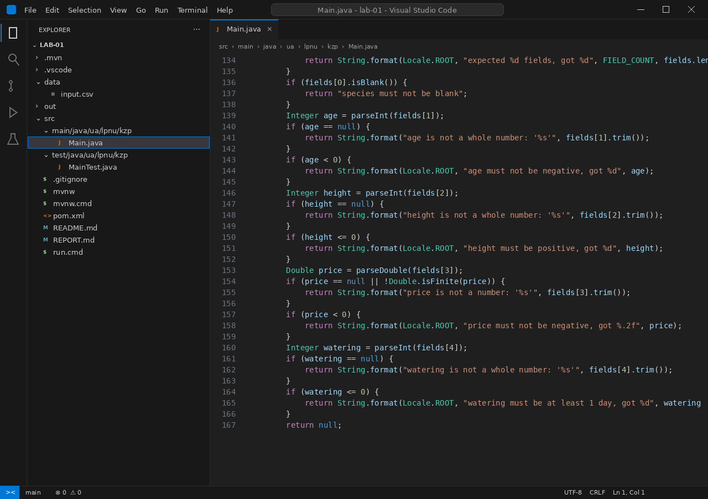
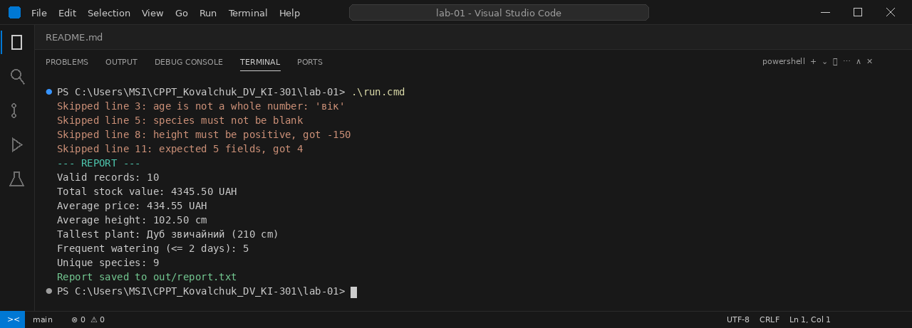
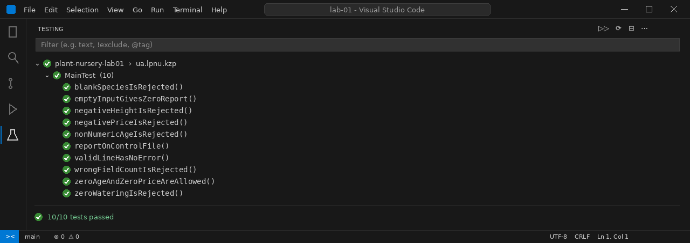

**Лабораторна робота №1**

Maven-проєкт і обробка CSV-даних у Java.

**Мета роботи:** створити наскрізний Java-продукт на Maven: налаштувати
збирання, тести JUnit 5, статичний аналізатор, виконуваний JAR і CI, а
також реалізувати першу версію програми, яка читає CSV-файл предметної
області, перевіряє записи й формує текстовий звіт.

**Завдання:** створити репозиторій із Maven Wrapper, pom.xml (Java 17,
UTF-8, JUnit 5, SpotBugs, Shade), GitHub Actions на трьох ОС;
реалізувати читання data/input.csv, перевірку кожного поля, пропуск
хибних рядків із номером і причиною, обчислення показників і запис звіту
у файл.

**Індивідуальне завдання:**

| 12  | Розсадник рослин. Рослина: вид, вік (роки), висота (см), ціна (грн), періодичність поливу (дні). Звіт: кількість коректних записів, загальна вартість, середня ціна, середня висота, найвища рослина, кількість рослин із частим поливом (не рідше ніж раз на 2 дні), кількість унікальних видів. |
|-----|---------------------------------------------------------------------------------------------------------------------------------------------------------------------------------------------------------------------------------------------------------------------------------------------------|

**Посилання на репозиторій:**

| Репозиторій             | [<u>https://github.com/kovalchukdima0511-ai/CPPT_Kovalchuk_DV_KI-301</u>](https://github.com/kovalchukdima0511-ai/CPPT_Kovalchuk_DV_KI-301)                                                       |
|-------------------------|---------------------------------------------------------------------------------------------------------------------------------------------------------------------------------------------------|
| Код роботи (тег v1.0.0) | [<u>https://github.com/kovalchukdima0511-ai/CPPT_Kovalchuk_DV_KI-301/tree/v1.0.0/lab-01</u>](https://github.com/kovalchukdima0511-ai/CPPT_Kovalchuk_DV_KI-301/tree/v1.0.0/lab-01)                 |
| Звіт у репозиторії      | [<u>https://github.com/kovalchukdima0511-ai/CPPT_Kovalchuk_DV_KI-301/blob/main/lab-01/REPORT.md</u>](https://github.com/kovalchukdima0511-ai/CPPT_Kovalchuk_DV_KI-301/blob/main/lab-01/REPORT.md) |
| GitHub Actions          | [<u>https://github.com/kovalchukdima0511-ai/CPPT_Kovalchuk_DV_KI-301/actions/workflows/ci.yml</u>](https://github.com/kovalchukdima0511-ai/CPPT_Kovalchuk_DV_KI-301/actions/workflows/ci.yml)     |

**1. Структура проєкту та інфраструктура**

Кожна лабораторна робота — окрема папка репозиторію, яку можна відкрити
у VS Code через File → Open Folder. Для Java-робіт використано однаковий
каркас:

| **Файл**                     | **Призначення**                                                                                                        |
|------------------------------|------------------------------------------------------------------------------------------------------------------------|
| pom.xml                      | Java 17 (release), кодування UTF-8, JUnit 5.11, Surefire, SpotBugs (фаза verify), Shade — виконуваний JAR з Main-Class |
| mvnw, mvnw.cmd, .mvn/wrapper | Maven Wrapper: під час першого запуску завантажує Maven 3.9.9, тому окремо встановлювати Maven не потрібно             |
| run.cmd                      | запуск без Maven: компіляція javac і запуск java з кодуванням консолі UTF-8                                            |
| .vscode/launch.json          | конфігурація кнопки Run у VS Code (робоча тека — папка лабораторної)                                                   |
| .github/workflows/ci.yml     | GitHub Actions: verify і запуск JAR на Ubuntu, Windows, macOS, JAR як артефакт                                         |
| data/input.csv               | контрольні дані варіанта                                                                                               |

<table>
<colgroup>
<col style="width: 100%" />
</colgroup>
<thead>
<tr class="header">
<th>
&lt;maven.compiler.release&gt;17&lt;/maven.compiler.release&gt;

&lt;project.build.sourceEncoding&gt;UTF-8&lt;/project.build.sourceEncoding&gt;

&lt;project.reporting.outputEncoding&gt;UTF-8&lt;/project.reporting.outputEncoding&gt;

&lt;junit.version&gt;5.11.3&lt;/junit.version&gt;

&lt;main.class&gt;ua.lpnu.kzp.Main&lt;/main.class&gt;
</th>
</tr>
</thead>
<tbody>
</tbody>
</table>

*Лістинг 1. Властивості збирання (pom.xml)*

**2. Формат вхідних даних і правила перевірки**

Кожен рядок файлу містить п'ять полів, розділених крапкою з комою. На
цьому етапі запис зберігається як масив рядків, а поля беруться за
індексами fields\[0\]…fields\[4\].

<table>
<colgroup>
<col style="width: 100%" />
</colgroup>
<thead>
<tr class="header">
<th>
вид;вік;висота;ціна;полив

Туя західна;3;120;450.00;3
</th>
</tr>
</thead>
<tbody>
</tbody>
</table>

*Рис. 1. Формат рядка вхідного файлу (перший рядок — пояснення полів, у
файлі його немає)*

| **Поле** | **Тип**      | **Правило**                                           |
|----------|--------------|-------------------------------------------------------|
| вид      | текст        | не порожній                                           |
| вік      | ціле         | не від'ємний (сіянець може мати 0 років)              |
| висота   | ціле, см     | більша за нуль — рослина нульової висоти не має сенсу |
| ціна     | дробове, грн | скінченне число, не від'ємне                          |
| полив    | ціле, дні    | не менше 1 дня                                        |

<table>
<colgroup>
<col style="width: 100%" />
</colgroup>
<thead>
<tr class="header">
<th>
static String validate(String[] fields) {

if (fields.length != FIELD_COUNT) {

return String.format(Locale.ROOT, "expected %d fields, got %d",
FIELD_COUNT, fields.length);

}

if (fields[0].isBlank()) {

return "species must not be blank";

}

Integer age = parseInt(fields[1]);

if (age == null) {

return String.format("age is not a whole number: '%s'",
fields[1].trim());

}

if (age &lt; 0) {

return String.format(Locale.ROOT, "age must not be negative, got %d",
age);

}

Integer height = parseInt(fields[2]);

if (height == null) {

return String.format("height is not a whole number: '%s'",
fields[2].trim());

}

if (height &lt;= 0) {

return String.format(Locale.ROOT, "height must be positive, got %d",
height);

}

Double price = parseDouble(fields[3]);

if (price == null || !Double.isFinite(price)) {

return String.format("price is not a number: '%s'",
fields[3].trim());

}

if (price &lt; 0) {

return String.format(Locale.ROOT, "price must not be negative, got
%.2f", price);

}

Integer watering = parseInt(fields[4]);

if (watering == null) {

return String.format("watering is not a whole number: '%s'",
fields[4].trim());

}

if (watering &lt;= 0) {

return String.format(Locale.ROOT, "watering must be at least 1 day,
got %d", watering);

}

return null;

}
</th>
</tr>
</thead>
<tbody>
</tbody>
</table>

*Лістинг 2. Перевірка полів одного рядка (Main.java)*

Метод повертає текст помилки або null. Цикл читання додає номер рядка,
тому користувач бачить, який саме рядок файлу треба виправити, а обробка
решти рядків не переривається.

**3. Обчислення показників**

<table>
<colgroup>
<col style="width: 100%" />
</colgroup>
<thead>
<tr class="header">
<th>
for (String[] fields : records) {

String name = fields[0].trim();

int height = Integer.parseInt(fields[2].trim());

double price = Double.parseDouble(fields[3].trim());

int watering = Integer.parseInt(fields[4].trim());

totalValue += price;

totalHeight += height;

if (height &gt; maxHeight) {

maxHeight = height;

tallest = name;

}

if (watering &lt;= FREQUENT_WATERING_DAYS) {

frequent++;

}

species.add(name);

}
</th>
</tr>
</thead>
<tbody>
</tbody>
</table>

*Лістинг 3. Обчислення показників у циклі (Main.java)*

> • **Найвища рослина** — оновлюється лише за строго більшої висоти,
> тому за рівної висоти залишається перша у файлі.
>
> • **Унікальні види** — HashSet\<String\>: дві «Троянди чайні»
> рахуються один раз.
>
> • **Порожній файл** — середні значення 0.00, найвища рослина «-»;
> ділення на нуль неможливе.
>
> • **Числа** форматуються через Locale.ROOT, тому десятковий роздільник
> — крапка на будь-якій ОС.

**4. Результат роботи**

Контрольний файл містить 14 рядків: 10 коректних і 4 хибні (нечисловий
вік, порожній вид, від'ємна висота, бракує поля). Серед коректних є
дубль виду, однакова висота двох рослин (180 см) і вид із комою та
лапками в назві.

<table>
<colgroup>
<col style="width: 100%" />
</colgroup>
<thead>
<tr class="header">
<th>
Туя західна;3;120;450.00;3

Троянда чайна;1;45;180.00;2

Хризантема садова;вік;30;90.00;2

Дуб звичайний;5;210;950.00;7

;2;40;100.00;2

Лаванда вузьколиста;2;35;120.00;3

Клен гостролистий;4;180;700.00;5

Береза повисла;3;-150;500.00;4

Тюльпан Дарвіна;1;40;35.50;1

Півонія молочноквіткова;3;70;260.00;2

Орхідея фаленопсис;1;25;300.00

Ялина колюча;6;180;1200.00;6

Троянда чайна;2;55;210.00;2

Троянда "Глорія Дей", плетиста;2;90;240.00;2
</th>
</tr>
</thead>
<tbody>
</tbody>
</table>

*Рис. 2. Вхідний файл data/input.csv*

*Рис. 3. Структура проєкту у VS Code та перевірка полів у Main.java*

*Рис. 4. Результат запуску програми*

Перевірка: сума цін 450 + 180 + 950 + 120 + 700 + 35.5 + 260 + 1200 +
210 + 240 = 4345.50 грн, середня ціна 434.55 грн; сума висот 1025 см,
середня 102.50 см. Полив не рідше ніж раз на 2 дні мають 5 рослин.
Унікальних видів 9, бо «Троянда чайна» трапляється двічі.

Програму можна запустити трьома способами: кнопкою Run у VS Code
(конфігурація .vscode/launch.json), скриптом run.cmd без Maven або через
Maven Wrapper: mvnw.cmd verify (тести + SpotBugs), mvnw.cmd package і
java -jar target/plant-nursery-lab01-1.0.0.jar.

**5. Тестування**

Клас MainTest містить 10 тестів JUnit 5: коректний рядок, граничні
значення (вік 0, ціна 0), кожен тип помилки, звіт на контрольному файлі
та звіт для порожнього входу.

*Рис. 5. Результати тестів у VS Code (вкладка Testing)*

**Використання ШІ:**

Під час виконання роботи використовувався ШІ-асистент Claude
(Anthropic): налаштування pom.xml і CI, пояснення Maven-фаз, написання
частини коду й тестів, оформлення README. Усі пропозиції я переглянув,
запустив і перевірив тестами; код, який не міг пояснити, не приймав.
Відповідальність за остаточний код і звіт несу я.

**Висновок:**

На цій лабораторній роботі я створив Maven-проєкт із Wrapper, JUnit 5,
SpotBugs, виконуваним JAR і CI на трьох ОС, а також першу версію
програми розсадника рослин: вона читає CSV у UTF-8, пропускає хибні
рядки з поясненням і формує звіт. Поля поки що беруться за індексами
масиву, а правила перевірки розкидані по методу validate — у
лабораторній роботі №2 запис стане класом Plant із перевіркою в
конструкторі.
