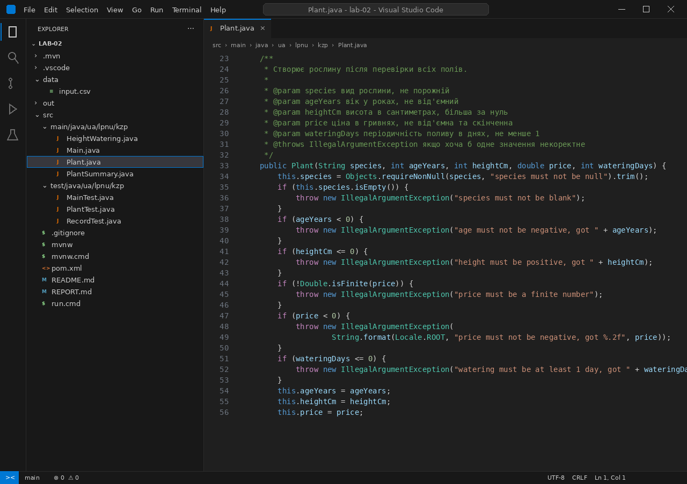
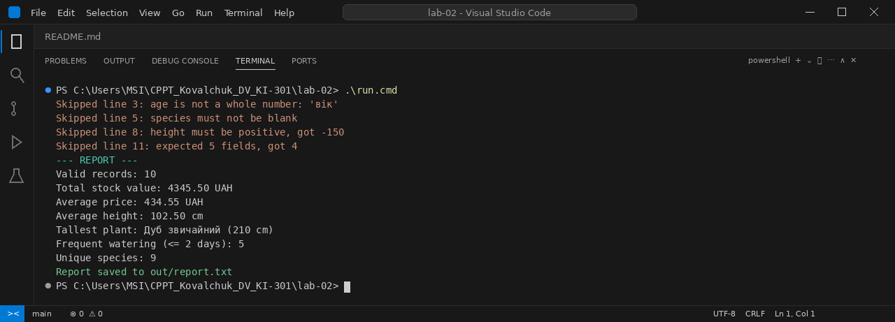
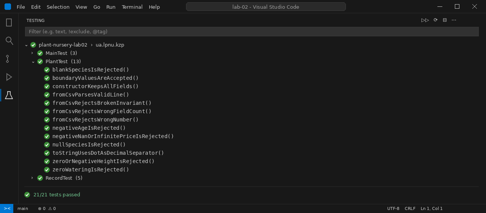

**Лабораторна робота №2**

Класи, record і інкапсуляція в Java-проєкті.

**Мета роботи:** перебудувати предметну частину продукту: замість рядків
і паралельних змінних використати власний клас із перевіркою стану,
record для незмінних допоміжних значень і тести, які підтверджують
збереження поведінки.

**Завдання:** створити клас-сутність Plant із private final-полями,
конструктором з перевіркою інваріантів, фабрикою fromCsv і toString
через Locale.ROOT; створити record HeightWatering і PlantSummary;
замінити масиви рядків списком об'єктів без зміни звіту; додати тести
конструктора, фабрики та record.

**Індивідуальне завдання:**

| 12  | Розсадник рослин. Клас-сутність Plant, допоміжний record HeightWatering. Мінімальна валідація: вид/назва не порожні; висота, ціна й інтервал поливу ≥ 0. |
|-----|----------------------------------------------------------------------------------------------------------------------------------------------------------|

**Посилання на репозиторій:**

| Репозиторій             | [<u>https://github.com/kovalchukdima0511-ai/CPPT_Kovalchuk_DV_KI-301</u>](https://github.com/kovalchukdima0511-ai/CPPT_Kovalchuk_DV_KI-301)                                                       |
|-------------------------|---------------------------------------------------------------------------------------------------------------------------------------------------------------------------------------------------|
| Код роботи (тег v1.1.0) | [<u>https://github.com/kovalchukdima0511-ai/CPPT_Kovalchuk_DV_KI-301/tree/v1.1.0/lab-02</u>](https://github.com/kovalchukdima0511-ai/CPPT_Kovalchuk_DV_KI-301/tree/v1.1.0/lab-02)                 |
| Звіт у репозиторії      | [<u>https://github.com/kovalchukdima0511-ai/CPPT_Kovalchuk_DV_KI-301/blob/main/lab-02/REPORT.md</u>](https://github.com/kovalchukdima0511-ai/CPPT_Kovalchuk_DV_KI-301/blob/main/lab-02/REPORT.md) |
| GitHub Actions          | [<u>https://github.com/kovalchukdima0511-ai/CPPT_Kovalchuk_DV_KI-301/actions/workflows/ci.yml</u>](https://github.com/kovalchukdima0511-ai/CPPT_Kovalchuk_DV_KI-301/actions/workflows/ci.yml)     |

**1. Стан до і після роботи**

| **Елемент** | **Робота №1**                  | **Робота №2**                       |
|-------------|--------------------------------|-------------------------------------|
| Один запис  | String\[\] і поля за індексами | об'єкт Plant                        |
| Перевірка   | метод validate у Main          | конструктор Plant і фабрика fromCsv |
| Набір даних | List\<String\[\]\>             | List\<Plant\>                       |
| Показники   | окремі змінні                  | record PlantSummary                 |
| Звіт        | —                              | без змін (той самий текст)          |

**2. Клас-сутність Plant**

Усі поля private final, сеттерів немає: рослина в розсаднику не змінює
вид, а нові вимірювання оформлюються новим записом. Конструктор
перевіряє всі правила до присвоєння, тому некоректний об'єкт не
створюється й не потрапляє до статистики.

<table>
<colgroup>
<col style="width: 100%" />
</colgroup>
<thead>
<tr class="header">
<th>
public Plant(String species, int ageYears, int heightCm, double
price, int wateringDays) {

this.species = Objects.requireNonNull(species, "species must not be
null").trim();

if (this.species.isEmpty()) {

throw new IllegalArgumentException("species must not be blank");

}

if (ageYears &lt; 0) {

throw new IllegalArgumentException("age must not be negative, got " +
ageYears);

}

if (heightCm &lt;= 0) {

throw new IllegalArgumentException("height must be positive, got " +
heightCm);

}

if (!Double.isFinite(price)) {

throw new IllegalArgumentException("price must be a finite
number");

}

if (price &lt; 0) {

throw new IllegalArgumentException(

String.format(Locale.ROOT, "price must not be negative, got %.2f",
price));

}

if (wateringDays &lt;= 0) {

throw new IllegalArgumentException("watering must be at least 1 day,
got " + wateringDays);

}

this.ageYears = ageYears;

this.heightCm = heightCm;

this.price = price;

this.wateringDays = wateringDays;

}
</th>
</tr>
</thead>
<tbody>
</tbody>
</table>

*Лістинг 1. Конструктор з перевіркою інваріантів (Plant.java)*

| **Інваріант**        | **Повідомлення**                                           |
|----------------------|------------------------------------------------------------|
| вид не null          | species must not be null (NullPointerException)            |
| вид не порожній      | species must not be blank                                  |
| вік ≥ 0              | age must not be negative, got N                            |
| висота \> 0          | height must be positive, got N                             |
| ціна скінченна й ≥ 0 | price must be a finite number / price must not be negative |
| полив ≥ 1            | watering must be at least 1 day, got N                     |

Мінімальна валідація варіанта дозволяє висоту й інтервал ≥ 0, але
методичка вимагає «більше нуля» там, де нуль позбавлений предметного
сенсу: рослина висотою 0 см і полив «кожні 0 днів» неможливі. Вік 0 і
ціна 0 (подарунковий сіянець) дозволені.

**3. Фабричний метод fromCsv і record**

<table>
<colgroup>
<col style="width: 100%" />
</colgroup>
<thead>
<tr class="header">
<th>
public static Plant fromCsv(String line) {

Objects.requireNonNull(line, "line must not be null");

String[] fields = line.split(";", -1);

if (fields.length != FIELD_COUNT) {

throw new IllegalArgumentException(

"expected " + FIELD_COUNT + " fields, got " + fields.length);

}

return new Plant(

fields[0],

parseInt(fields[1], "age"),

parseInt(fields[2], "height"),

parseDouble(fields[3], "price"),

parseInt(fields[4], "watering"));

}
</th>
</tr>
</thead>
<tbody>
</tbody>
</table>

*Лістинг 2. Фабрика fromCsv (Plant.java)*

Фабрика відповідає за структуру рядка й типи чисел, конструктор — за
значення. Помилка NumberFormatException загортається в
IllegalArgumentException із назвою поля та збереженою причиною. Номер
рядка додає цикл у Main.load.

<table>
<colgroup>
<col style="width: 100%" />
</colgroup>
<thead>
<tr class="header">
<th>
public record HeightWatering(int heightCm, int wateringDays)
{

public HeightWatering {

if (heightCm &lt;= 0 || wateringDays &lt;= 0) {

throw new IllegalArgumentException("height and watering must be
positive");

}

}

public boolean needsFrequentWatering() {

return wateringDays &lt;= FREQUENT_WATERING_DAYS;

}

}
</th>
</tr>
</thead>
<tbody>
</tbody>
</table>

*Лістинг 3. Record HeightWatering*

Record автоматично отримує конструктор, методи доступу heightCm(),
wateringDays(), а також equals, hashCode і toString. Компактний
конструктор перевіряє значення. Другий record PlantSummary зберігає
вісім підсумкових показників і має статичний метод from(List\<Plant\>);
його компоненти — числа й рядок, тому проблеми зі змінними списками
всередині record немає.

<table>
<colgroup>
<col style="width: 100%" />
</colgroup>
<thead>
<tr class="header">
<th>
static List&lt;Plant&gt; load(List&lt;String&gt; lines,
List&lt;String&gt; errors) {

List&lt;Plant&gt; plants = new ArrayList&lt;&gt;();

for (int lineNumber = 1; lineNumber &lt;= lines.size(); lineNumber++)
{

String line = lines.get(lineNumber - 1);

if (line.isBlank()) {

continue;

}

try {

plants.add(Plant.fromCsv(line));

} catch (IllegalArgumentException exception) {

errors.add(String.format(Locale.ROOT, "Skipped line %d: %s",

lineNumber, exception.getMessage()));

}

}

return plants;

}
</th>
</tr>
</thead>
<tbody>
</tbody>
</table>

*Лістинг 4. Заміна рядків об'єктами в циклі читання (Main.java)*

**4. Результат роботи і порівняння поведінки**

*Рис. 1. Структура проєкту та клас Plant у VS Code*

*Рис. 2. Результат запуску програми*

| **Показник**                       | **Робота №1**          | **Робота №2**          |
|------------------------------------|------------------------|------------------------|
| Пропущені рядки                    | 3, 5, 8, 11            | 3, 5, 8, 11            |
| Valid records                      | 10                     | 10                     |
| Total stock value                  | 4345.50 UAH            | 4345.50 UAH            |
| Average price / height             | 434.55 / 102.50        | 434.55 / 102.50        |
| Tallest plant                      | Дуб звичайний (210 cm) | Дуб звичайний (210 cm) |
| Frequent watering / Unique species | 5 / 9                  | 5 / 9                  |

Текст звіту побайтово збігається з роботою №1 — це перевіряє тест
MainTest.reportOnControlFile, перенесений із попередньої роботи.
Програму можна запустити трьома способами: кнопкою Run у VS Code
(конфігурація .vscode/launch.json), скриптом run.cmd без Maven або через
Maven Wrapper: mvnw.cmd verify (тести + SpotBugs), mvnw.cmd package і
java -jar target/plant-nursery-lab02-1.1.0.jar.

**5. Тестування**

| **Клас тестів** | **Що перевіряє**                                                                                                                                                                                   |
|-----------------|----------------------------------------------------------------------------------------------------------------------------------------------------------------------------------------------------|
| PlantTest       | збереження полів, граничні значення, null і порожній вид, від'ємні вік і висота, ціна -0.01/NaN/∞, полив 0, fromCsv: коректний рядок, кількість полів, хибне число, порушення інваріанта, toString |
| RecordTest      | рівність і hashCode record, межа частого поливу (2 — так, 3 — ні), підсумок для двох рослин, від'ємні показники                                                                                    |
| MainTest        | звіт на контрольному файлі (перенесено з роботи №1), порожній вхід, хибні рядки не потрапляють до списку                                                                                           |

*Рис. 3. Результати 21 тестів у VS Code*

**Використання ШІ:**

Під час виконання роботи використовувався ШІ-асистент Claude
(Anthropic): пояснення інкапсуляції та record на коді проєкту, написання
частини класів і тестів, перевірка javadoc і узгодженості повідомлень
про помилки. Усі пропозиції я переглянув, запустив і перевірив тестами;
код, який не міг пояснити, не приймав. Відповідальність за остаточний
код і звіт несу я.

**Висновок:**

На цій лабораторній роботі я замінив рядкові записи класом Plant з
інкапсульованим незмінним станом: перевірка перенесена в конструктор,
розбір — у фабрику fromCsv, а підсумки — у record PlantSummary і
HeightWatering. Звіт залишився таким самим, що підтверджують перенесені
тести. Цей стан став основою для роботи №3, де Plant стане абстрактним
базовим типом для дерев і квітів.
