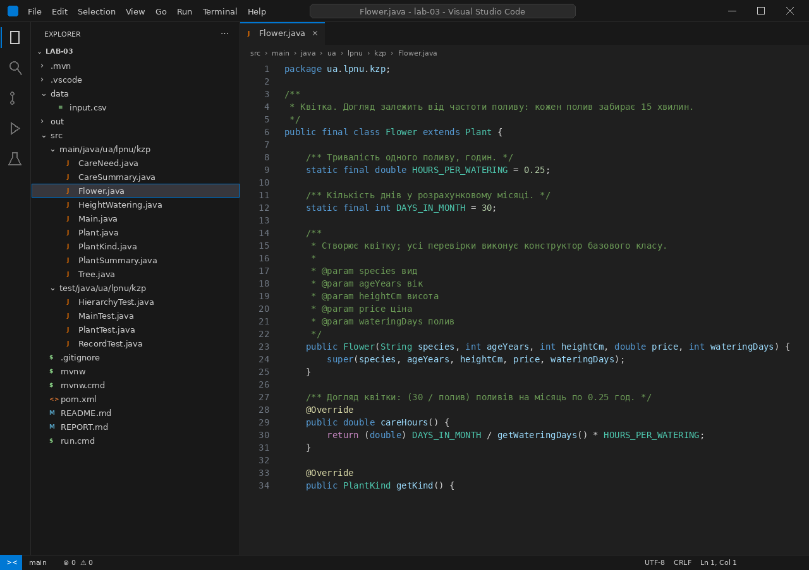
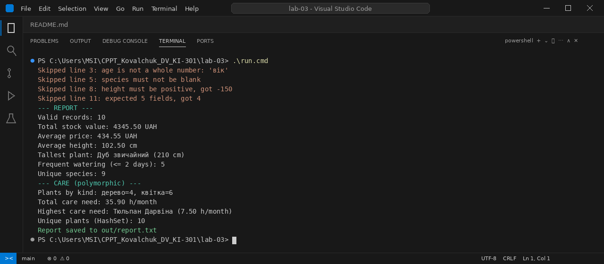
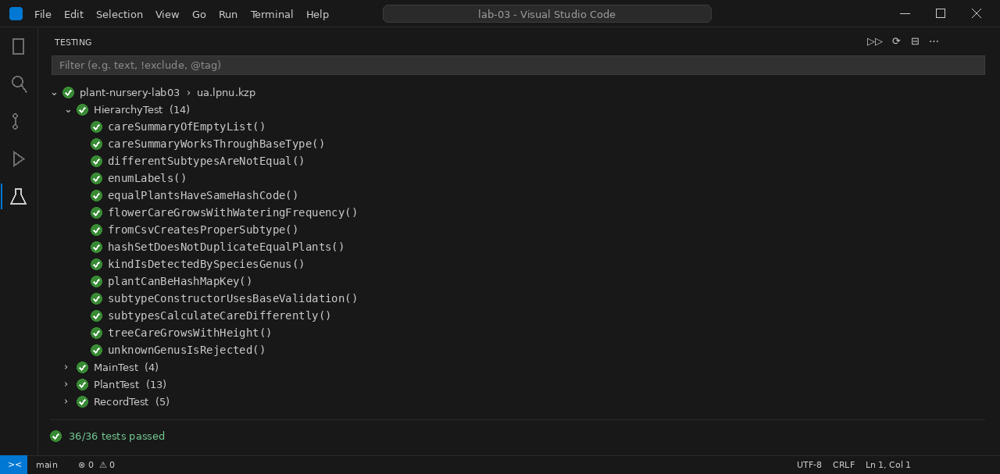

**Лабораторна робота №3**

Спадкування, інтерфейси й поліморфізм у Java-проєкті.

**Мета роботи:** розширити класову модель: винести спільні властивості
до базового типу, створити підтипи з різною поведінкою, додати enum для
категорії, реалізувати equals/hashCode і обробляти різнорідні об'єкти
через спільний тип.

**Завдання:** зробити Plant абстрактним базовим класом, створити підтипи
Tree і Flower з різною реалізацією потреби в догляді, інтерфейс
CareNeed, enum PlantKind, узгоджені equals/hashCode; обробляти колекцію
без if/switch за підтипом; зберегти попередній звіт і тести.

**Індивідуальне завдання:**

| 12  | Розсадник рослин. Базовий тип Plant, підтипи Tree, Flower, enum PlantKind, поліморфна операція — потреба в догляді. |
|-----|---------------------------------------------------------------------------------------------------------------------|

**Посилання на репозиторій:**

| Репозиторій             | [<u>https://github.com/kovalchukdima0511-ai/CPPT_Kovalchuk_DV_KI-301</u>](https://github.com/kovalchukdima0511-ai/CPPT_Kovalchuk_DV_KI-301)                                                       |
|-------------------------|---------------------------------------------------------------------------------------------------------------------------------------------------------------------------------------------------|
| Код роботи (тег v1.2.0) | [<u>https://github.com/kovalchukdima0511-ai/CPPT_Kovalchuk_DV_KI-301/tree/v1.2.0/lab-03</u>](https://github.com/kovalchukdima0511-ai/CPPT_Kovalchuk_DV_KI-301/tree/v1.2.0/lab-03)                 |
| Звіт у репозиторії      | [<u>https://github.com/kovalchukdima0511-ai/CPPT_Kovalchuk_DV_KI-301/blob/main/lab-03/REPORT.md</u>](https://github.com/kovalchukdima0511-ai/CPPT_Kovalchuk_DV_KI-301/blob/main/lab-03/REPORT.md) |
| GitHub Actions          | [<u>https://github.com/kovalchukdima0511-ai/CPPT_Kovalchuk_DV_KI-301/actions/workflows/ci.yml</u>](https://github.com/kovalchukdima0511-ai/CPPT_Kovalchuk_DV_KI-301/actions/workflows/ci.yml)     |

**1. Ієрархія типів**

<table>
<colgroup>
<col style="width: 100%" />
</colgroup>
<thead>
<tr class="header">
<th>
«interface» CareNeed

careHours(): double

▲

«sealed abstract» Plant ──────── PlantKind «enum»

species, ageYears, heightCm, TREE("дерево")

price, wateringDays FLOWER("квітка")

careHours(), getKind() create(...), fromSpecies(...)

▲ ▲

final Tree final Flower

1 + висота/100 30/полив · 0.25
</th>
</tr>
</thead>
<tbody>
</tbody>
</table>

*Рис. 1. Діаграма ієрархії рослин*

Спільні поля та всі інваріанти залишилися в одному місці — у
protected-конструкторі Plant. Підтипи лише викликають super(...) і
реалізують careHours(). Ієрархія запечатана (sealed ... permits Tree,
Flower) — завдання із зірочкою: компілятор не дозволить створити інший
підтип.

<table>
<colgroup>
<col style="width: 100%" />
</colgroup>
<thead>
<tr class="header">
<th>
/** Догляд дерева: 1 год + 1 год на кожен метр висоти. */

@Override

public double careHours() {

return BASE_HOURS + HOURS_PER_METER * getHeightCm() / 100.0;

}

/** Догляд квітки: (30 / полив) поливів на місяць по 0.25 год. */

@Override

public double careHours() {

return (double) DAYS_IN_MONTH / getWateringDays() *
HOURS_PER_WATERING;

}
</th>
</tr>
</thead>
<tbody>
</tbody>
</table>

*Лістинг 1. Поліморфна операція в підтипах (Tree.java, Flower.java)*

| **Підтип** | **Формула, год/міс** | **Пояснення**                                                       |
|------------|----------------------|---------------------------------------------------------------------|
| Tree       | 1 + висота / 100     | базовий догляд + обрізка й полив великої крони: 1 год на кожен метр |
| Flower     | 30 / полив × 0.25    | кількість поливів на місяць × 15 хвилин на один полив               |

**2. Enum PlantKind і створення підтипу**

Категорію визначає рід рослини — перше слово виду («Туя західна» → туя →
TREE). Кожна константа enum має власну реалізацію create, тому фабрика
Plant.fromCsv не містить if або switch за підтипом. Значення enum
порівнюються через ==, бо кожна константа існує в одному екземплярі.

<table>
<colgroup>
<col style="width: 100%" />
</colgroup>
<thead>
<tr class="header">
<th>
public static PlantKind fromSpecies(String species) {

String genus = species.trim().split("\\s+", 2)[0].replace("\"",
"").toLowerCase(Locale.ROOT);

for (PlantKind kind : values()) {

if (kind.genera.contains(genus)) {

return kind;

}

}

throw new IllegalArgumentException("unknown plant kind for species:
'" + species.trim() + "'");

}
</th>
</tr>
</thead>
<tbody>
</tbody>
</table>

*Лістинг 2. Визначення категорії за родом (PlantKind.java)*

**3. Рівність, HashSet і поліморфна колекція**

<table>
<colgroup>
<col style="width: 100%" />
</colgroup>
<thead>
<tr class="header">
<th>
public final boolean equals(Object other) {

if (this == other) {

return true;

}

if (other == null || getClass() != other.getClass()) {

return false;

}

Plant plant = (Plant) other;

return ageYears == plant.ageYears

&amp;&amp; heightCm == plant.heightCm

&amp;&amp; Double.compare(price, plant.price) == 0

&amp;&amp; wateringDays == plant.wateringDays

&amp;&amp; species.equals(plant.species);

}

public final int hashCode() {

return Objects.hash(getClass(), species, ageYears, heightCm, price,
wateringDays);

}
</th>
</tr>
</thead>
<tbody>
</tbody>
</table>

*Лістинг 3. Узгоджені equals і hashCode (Plant.java)*

> • **Критерій рівності** — той самий клас (getClass) і всі п'ять полів.
> Дерево й квітка з однаковими полями не рівні.
>
> • **HashSet** — дві однакові «Троянди чайні» дають один елемент; на
> контрольних даних 10 рослин логічно різні (дві троянди мають різний
> вік).
>
> • **Незмінність** — поля final, тому об'єкт безпечно використовувати
> ключем HashMap.
>
> • **Спадкування чи композиція** — дерево і квітка справді «є
> різновидом» рослини (is-a), мають спільний стан і правила, тому обрано
> спадкування; звіт (CareSummary) лише використовує рослини — це
> композиція.

<table>
<colgroup>
<col style="width: 100%" />
</colgroup>
<thead>
<tr class="header">
<th>
public static CareSummary from(List&lt;? extends Plant&gt;
plants) {

Objects.requireNonNull(plants, "plants must not be null");

double total = 0.0;

double highest = 0.0;

String highestSpecies = "-";

Map&lt;PlantKind, Integer&gt; byKind = new
EnumMap&lt;&gt;(PlantKind.class);

for (Plant plant : plants) {

double hours = plant.careHours();

total += hours;

if (hours &gt; highest) {

highest = hours;

highestSpecies = plant.getSpecies();

}

byKind.merge(plant.getKind(), 1, Integer::sum);

}

int unique = new HashSet&lt;&gt;(plants).size();

return new CareSummary(total, highestSpecies, highest,

byKind.getOrDefault(PlantKind.TREE, 0),
byKind.getOrDefault(PlantKind.FLOWER, 0), unique);

}
</th>
</tr>
</thead>
<tbody>
</tbody>
</table>

*Лістинг 4. Обробка через базовий тип без instanceof (CareSummary.java)*

**4. Результат роботи**

*Рис. 2. Структура проєкту та підтип Flower у VS Code*

*Рис. 3. Результат запуску програми: основний звіт без змін і новий
розділ догляду*

Перевірка розділу догляду: дерева 2.20 + 3.10 + 2.80 + 2.80 = 10.90 год,
квіти 3.75 + 2.50 + 7.50 + 3.75 + 3.75 + 3.75 = 25.00 год, разом 35.90
год/міс. Найбільшої уваги потребує тюльпан, якого поливають щодня (7.50
год). Основний звіт збігається з роботою №2. Програму можна запустити
трьома способами: кнопкою Run у VS Code (конфігурація
.vscode/launch.json), скриптом run.cmd без Maven або через Maven
Wrapper: mvnw.cmd verify (тести + SpotBugs), mvnw.cmd package і java
-jar target/plant-nursery-lab03-1.2.0.jar.

**5. Тестування**

| **Клас тестів**                 | **Що перевіряє**                                                                                                                                                                                                                        |
|---------------------------------|-----------------------------------------------------------------------------------------------------------------------------------------------------------------------------------------------------------------------------------------|
| HierarchyTest                   | різні careHours для підтипів, залежність від висоти й поливу, валідація через super, визначення категорії, невідомий рід, правильний підтип з fromCsv, enum, equals/hashCode, HashSet, HashMap, нерівність різних підтипів, CareSummary |
| PlantTest, RecordTest, MainTest | тести роботи №2, перенесені на підтипи; звіт на контрольному файлі й новий розділ догляду                                                                                                                                               |

*Рис. 4. Результати 36 тестів у VS Code*

**Використання ШІ:**

Під час виконання роботи використовувався ШІ-асистент Claude
(Anthropic): обговорення вибору між абстрактним класом та інтерфейсом,
пояснення контракту equals/hashCode, написання частини підтипів і
тестів, рецензування відсутності розгалужень за підтипом. Усі пропозиції
я переглянув, запустив і перевірив тестами; код, який не міг пояснити,
не приймав. Відповідальність за остаточний код і звіт несу я.

**Висновок:**

На цій лабораторній роботі я перебудував модель у запечатану ієрархію
Plant → Tree, Flower з інтерфейсом CareNeed і enum PlantKind. Потреба в
догляді обчислюється поліморфно: звіт викликає один метод через базовий
тип і не знає конкретного підтипу. Узгоджені equals і hashCode
перевірено в HashSet і HashMap. Ця поліморфна колекція стала основою
роботи №4, де цикли замінено потоками.
