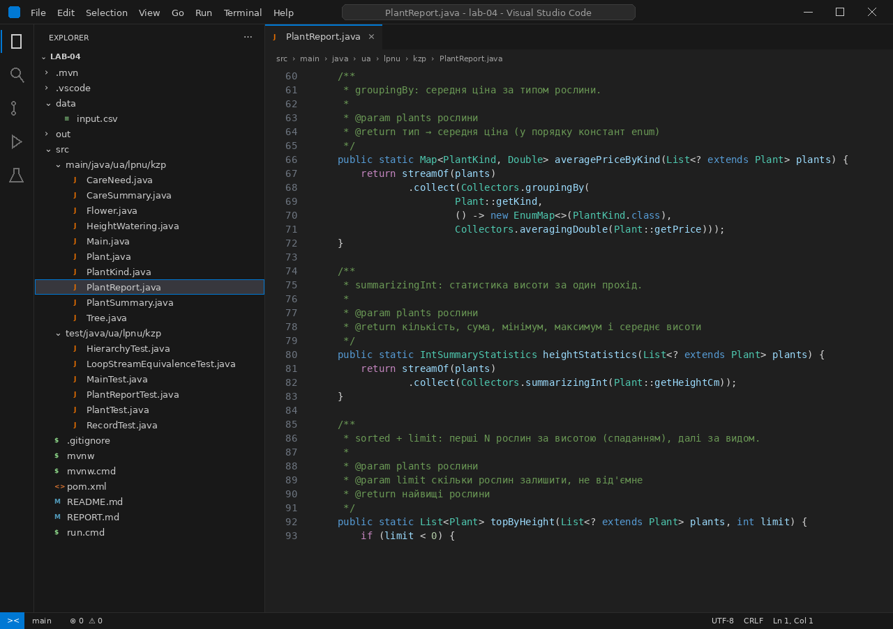
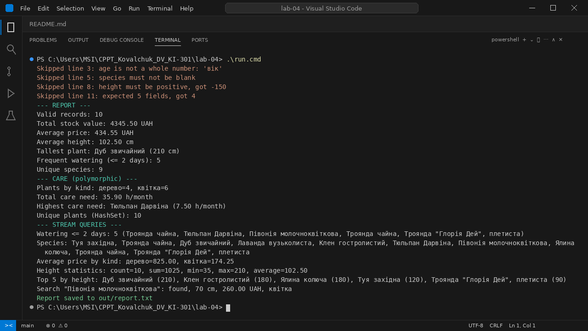
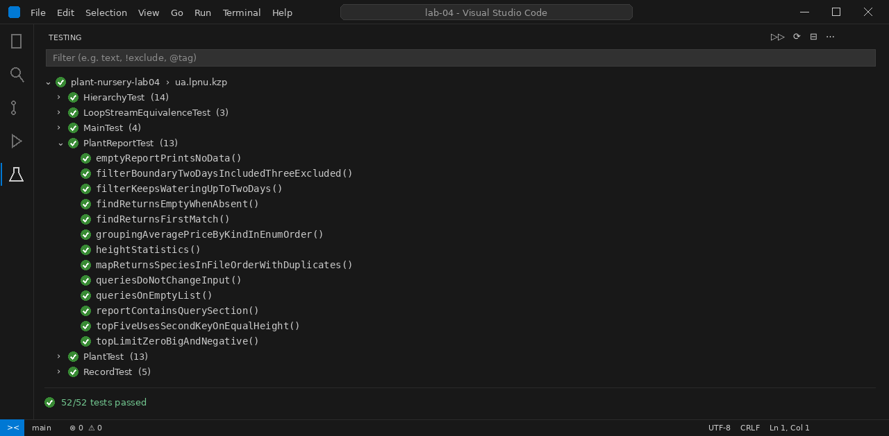

**Лабораторна робота №4**

Потокова обробка даних у Java-проєкті.

**Мета роботи:** замінити основні циклові обчислення предметної моделі
декларативними запитами Stream API, не змінюючи зовнішньої поведінки
програми; додати відбір, перетворення, групування, зведену статистику,
складене впорядкування та безпечний пошук.

**Завдання:** реалізувати для поліморфної колекції рослин запити filter,
map, groupingBy, summarizingInt, top-5 через складений компаратор,
sorted і limit, а також пошук з Optional; переписати показники
попередніх робіт потоками й довести еквівалентність тестом.

**Індивідуальне завдання:**

| 12  | Розсадник рослин. Рослина: вид, вік, висота, ціна, періодичність поливу (дні); фільтр – періодичність не більша за 2 дні; map – види; групування – середня ціна за типом; статистика – висота; top-5 – висота спаданням і вид; Optional – пошук за видом. |
|-----|-----------------------------------------------------------------------------------------------------------------------------------------------------------------------------------------------------------------------------------------------------------|

**Посилання на репозиторій:**

| Репозиторій             | [<u>https://github.com/kovalchukdima0511-ai/CPPT_Kovalchuk_DV_KI-301</u>](https://github.com/kovalchukdima0511-ai/CPPT_Kovalchuk_DV_KI-301)                                                       |
|-------------------------|---------------------------------------------------------------------------------------------------------------------------------------------------------------------------------------------------|
| Код роботи (тег v1.3.0) | [<u>https://github.com/kovalchukdima0511-ai/CPPT_Kovalchuk_DV_KI-301/tree/v1.3.0/lab-04</u>](https://github.com/kovalchukdima0511-ai/CPPT_Kovalchuk_DV_KI-301/tree/v1.3.0/lab-04)                 |
| Звіт у репозиторії      | [<u>https://github.com/kovalchukdima0511-ai/CPPT_Kovalchuk_DV_KI-301/blob/main/lab-04/REPORT.md</u>](https://github.com/kovalchukdima0511-ai/CPPT_Kovalchuk_DV_KI-301/blob/main/lab-04/REPORT.md) |
| GitHub Actions          | [<u>https://github.com/kovalchukdima0511-ai/CPPT_Kovalchuk_DV_KI-301/actions/workflows/ci.yml</u>](https://github.com/kovalchukdima0511-ai/CPPT_Kovalchuk_DV_KI-301/actions/workflows/ci.yml)     |

**1. Запити Stream API**

Усі запити зібрано в класі PlantReport. Кожен метод відкриває новий
потік над списком, не змінює сам список і нічого не друкує, тому його
легко перевірити окремим тестом.

| **Запит**                 | **Проміжні операції** | **Кінцева операція**                    | **Результат**            |
|---------------------------|-----------------------|-----------------------------------------|--------------------------|
| frequentlyWatered(list)   | filter                | toList()                                | List\<Plant\>            |
| speciesNames(list)        | map                   | toList()                                | List\<String\>           |
| averagePriceByKind(list)  | —                     | collect(groupingBy(…, averagingDouble)) | Map\<PlantKind, Double\> |
| heightStatistics(list)    | —                     | collect(summarizingInt(…))              | IntSummaryStatistics     |
| topByHeight(list, n)      | sorted, limit         | toList()                                | List\<Plant\>            |
| findBySpecies(list, name) | filter                | findFirst()                             | Optional\<Plant\>        |

<table>
<colgroup>
<col style="width: 100%" />
</colgroup>
<thead>
<tr class="header">
<th>
public static List&lt;Plant&gt; frequentlyWatered(List&lt;?
extends Plant&gt; plants) {

return streamOf(plants)

.filter(plant -&gt; plant.getWateringDays() &lt;=
FREQUENT_WATERING_DAYS)

.toList();

}

public static Map&lt;PlantKind, Double&gt;
averagePriceByKind(List&lt;? extends Plant&gt; plants) {

return streamOf(plants)

.collect(Collectors.groupingBy(

Plant::getKind,

() -&gt; new EnumMap&lt;&gt;(PlantKind.class),

Collectors.averagingDouble(Plant::getPrice)));

}

public static IntSummaryStatistics heightStatistics(List&lt;? extends
Plant&gt; plants) {

return streamOf(plants)

.collect(Collectors.summarizingInt(Plant::getHeightCm));

}

public static List&lt;Plant&gt; topByHeight(List&lt;? extends
Plant&gt; plants, int limit) {

if (limit &lt; 0) {

throw new IllegalArgumentException("limit must not be negative, got "
+ limit);

}

// sorted() стоїть перед limit(): спершу впорядковуємо всі, потім
беремо найкращі.

return streamOf(plants)

.sorted(BY_HEIGHT_DESC_THEN_SPECIES)

.limit(limit)

.toList();

}

public static Optional&lt;Plant&gt; findBySpecies(List&lt;? extends
Plant&gt; plants, String species) {

Objects.requireNonNull(species, "species must not be null");

return streamOf(plants)

.filter(plant -&gt; plant.getSpecies().equals(species))

.findFirst();

}
</th>
</tr>
</thead>
<tbody>
</tbody>
</table>

*Лістинг 1. Запити варіанта 12 (PlantReport.java)*

**2. Компаратор, групування та статистика**

<table>
<colgroup>
<col style="width: 100%" />
</colgroup>
<thead>
<tr class="header">
<th>
public static final Comparator&lt;Plant&gt;
BY_HEIGHT_DESC_THEN_SPECIES = Comparator

.comparingInt(Plant::getHeightCm)

.reversed()

.thenComparing(Plant::getSpecies);
</th>
</tr>
</thead>
<tbody>
</tbody>
</table>

*Лістинг 2. Складений компаратор (PlantReport.java)*

> • **Компаратор.** reversed() стоїть перед thenComparing, тому за
> спаданням упорядковано лише висоту, а за рівної висоти (клен і ялина,
> по 180 см) види йдуть за абеткою. sorted виконується перед limit.
>
> • **Групування.** Ключ — PlantKind, результат у EnumMap, тому ключі
> завжди в порядку оголошення: спершу дерева, потім квіти. Вкладений
> колектор averagingDouble рахує середню ціну в групі.
>
> • **Статистика.** summarizingInt за один прохід дає кількість, суму,
> мінімум, максимум і середнє висоти. Для порожнього списку звіт друкує
> «no data».
>
> • **Optional.** findBySpecies повертає першу рослину виду в порядку
> файлу або Optional.empty(); звіт перетворює результат на текст через
> map(...).orElse("not found") без перевірок на null.
>
> • **Тип параметра.** Методи приймають List\<? extends Plant\>, тому
> працюють і зі списком лише дерев.

**3. Заміна циклів потоками**

| **Показник**      | **Робота №3 (цикл)**       | **Робота №4 (потік)**                              |
|-------------------|----------------------------|----------------------------------------------------|
| Загальна вартість | totalValue += p.getPrice() | mapToDouble(Plant::getPrice).sum()                 |
| Середня висота    | сума, потім ділення        | mapToInt(Plant::getHeightCm).average().orElse(0.0) |
| Найвища рослина   | if (h \> maxHeight)        | max(comparingInt(Plant::getHeightCm))              |
| Частий полив      | frequent++                 | filter(...).count()                                |
| Унікальні види    | new HashSet\<\>()          | map(Plant::getSpecies).distinct().count()          |
| Догляд за типом   | if за kind                 | groupingBy(Plant::getKind, counting())             |

<table>
<colgroup>
<col style="width: 100%" />
</colgroup>
<thead>
<tr class="header">
<th>
public static PlantSummary from(List&lt;? extends Plant&gt;
plants) {

Objects.requireNonNull(plants, "plants must not be null");

double totalValue = plants.stream()

.mapToDouble(Plant::getPrice)

.sum();

double averagePrice = plants.stream()

.mapToDouble(Plant::getPrice)

.average()

.orElse(0.0);

double averageHeight = plants.stream()

.mapToInt(Plant::getHeightCm)

.average()

.orElse(0.0);

Optional&lt;? extends Plant&gt; tallest = plants.stream()

.max(Comparator.comparingInt(Plant::getHeightCm));

long frequent = plants.stream()

.filter(plant -&gt;
plant.heightWatering().needsFrequentWatering())

.count();

long unique = plants.stream()

.map(Plant::getSpecies)

.distinct()

.count();

return new PlantSummary(plants.size(), totalValue, averagePrice,
averageHeight,

tallest.map(Plant::getSpecies).orElse("-"),

tallest.map(Plant::getHeightCm).orElse(0),

(int) frequent, (int) unique);

}
</th>
</tr>
</thead>
<tbody>
</tbody>
</table>

*Лістинг 3. Показники роботи №1 через потоки (PlantSummary.java)*

Порожній випадок став явним: average() і max() повертають OptionalDouble
та Optional, тому значення для порожнього списку задається через orElse.
Stream.max за рівних елементів залишає перший — так само, як цикл зі
строгим порівнянням. Читання CSV лишилося циклом: для кожного хибного
рядка потрібен його номер, і порядок повідомлень має значення.

**4. Результат роботи**

*Рис. 1. Структура проєкту та запити PlantReport у VS Code*

*Рис. 2. Результат запуску програми з розділом потокових запитів*

Перевірка: середня ціна дерев (450 + 950 + 700 + 1200) / 4 = 825.00,
квітів 1045.50 / 6 = 174.25. У п'ятірці за висотою клен стоїть перед
ялиною завдяки другому ключу. Пошук «Півонія молочноквіткова» знаходить
рослину 70 см за 260.00 грн. Програму можна запустити трьома способами:
кнопкою Run у VS Code (конфігурація .vscode/launch.json), скриптом
run.cmd без Maven або через Maven Wrapper: mvnw.cmd verify (тести +
SpotBugs), mvnw.cmd package і java -jar
target/plant-nursery-lab04-1.3.0.jar.

**5. Еквівалентність і тестування**

Клас LoopStreamEquivalenceTest зберігає цикли версії 1.2.0 як еталон і
порівнює їх із потоковими показниками на контрольних даних, на
порожньому списку і на рівній висоті. Дробові значення порівнюються з
допуском 1e-9, бо потік може додавати числа в іншому порядку.

| **Обчислення**    | **Цикл**         | **Потік**              | **Результат**     |
|-------------------|------------------|------------------------|-------------------|
| Загальна вартість | += у циклі       | mapToDouble(...).sum() | 4345.50 = 4345.50 |
| Середня висота    | сума / кількість | average()              | 102.50 = 102.50   |
| Найвища рослина   | if (h \> max)    | max(...)               | Дуб = Дуб         |
| Унікальні види    | HashSet.size()   | distinct().count()     | 9 = 9             |
| Потреба в догляді | += careHours()   | mapToDouble(...).sum() | 35.90 = 35.90     |

| **Клас тестів**                                | **Що перевіряє**                                                                                                                                                                                                              |
|------------------------------------------------|-------------------------------------------------------------------------------------------------------------------------------------------------------------------------------------------------------------------------------|
| PlantReportTest                                | кожен запит на контрольних даних; межа фільтра (2 — так, 3 — ні); порядок груп; другий ключ сортування; N = 0, 100 і −1; перший збіг для дубля; порожній Optional; порожній список; незмінність вхідного списку; розділ звіту |
| LoopStreamEquivalenceTest                      | цикли роботи №3 і потоки дають однакові показники                                                                                                                                                                             |
| HierarchyTest, PlantTest, RecordTest, MainTest | тести попередніх робіт без змін                                                                                                                                                                                               |

*Рис. 3. Результати 52 тестів у VS Code*

**Використання ШІ:**

Під час виконання роботи використовувався ШІ-асистент Claude
(Anthropic): планування запитів, пояснення Stream API на коді проєкту,
написання частини коду й тестів еквівалентності, рецензування порядку
операцій sorted/limit. Усі пропозиції я переглянув, запустив і перевірив
тестами; код, який не міг пояснити, не приймав. Відповідальність за
остаточний код і звіт несу я.

**Висновок:**

На цій лабораторній роботі я ознайомився з потоковою обробкою даних у
Java: конвеєром із джерела, проміжних і кінцевої операцій, операціями
filter, map, sorted, limit, distinct, колекторами groupingBy,
averagingDouble, summarizingInt, складеними компараторами й типом
Optional. Усі показники тепер обчислюються потоками, а тест
еквівалентності підтверджує, що результати не змінилися. Клас чистих
запитів і модель стали основою роботи №5, де рослини зберігаються в
параметризованому сховищі та експортуються у CSV.
