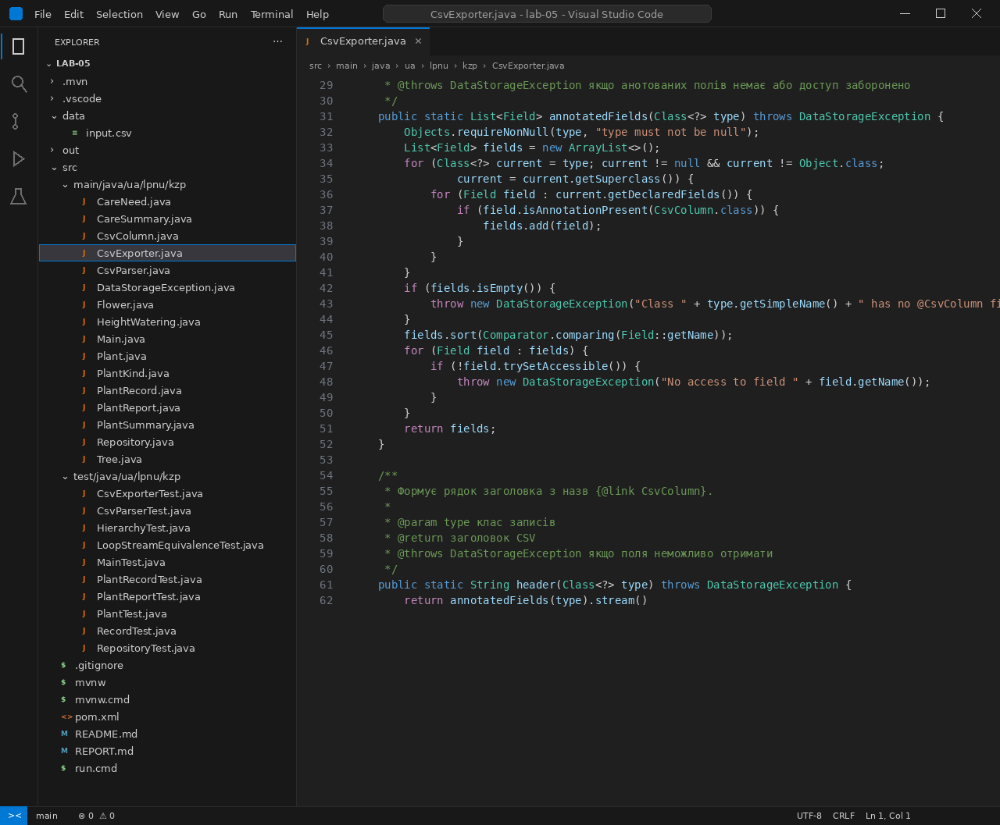
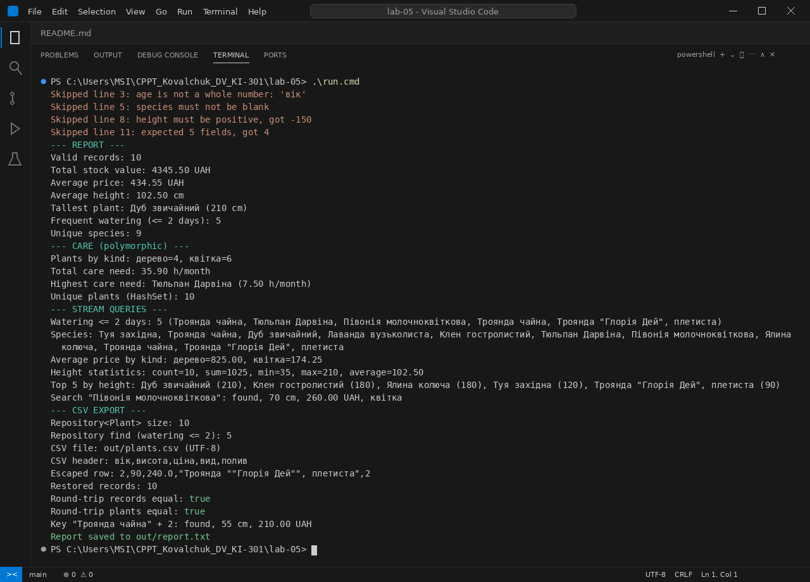
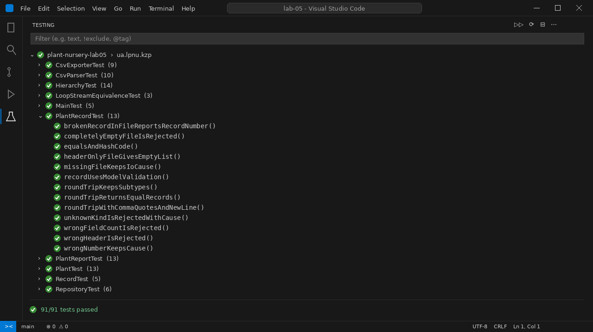

**Лабораторна робота №5**

Параметризоване сховище, винятки й CSV-експорт у Java-проєкті.

**Мета роботи:** завершити Java-застосунок наскрізного продукту:
замінити пряме зберігання даних у списку на параметризоване сховище,
додати власний виняток із ланцюгом причин, описати CSV-стовпці анотацією
та реалізувати універсальний експортер, який читає метадані рефлексією.
Дані записуються і читаються через Path та Files з явним UTF-8.

**Завдання:** створити Repository\<T\> (add, all, find за Predicate),
анотацію @CsvColumn (RUNTIME, FIELD), рефлексивний CsvExporter без
прив'язки до домену, документний CsvParser, власний DataStorageException
з cause; експортувати рослини, прочитати CSV назад і довести round-trip;
перевірити порожній набір, хибні поля, multiline-поле та файлову
помилку.

**Індивідуальне завдання:**

| 12  | Розсадник рослин. PlantRecord: species, ageYears, heightCm, price, wateringDays; CSV: вид, вік, висота, ціна, полив; ключ – species + ageYears. |
|-----|-------------------------------------------------------------------------------------------------------------------------------------------------|

**Посилання на репозиторій:**

| Репозиторій             | [<u>https://github.com/kovalchukdima0511-ai/CPPT_Kovalchuk_DV_KI-301</u>](https://github.com/kovalchukdima0511-ai/CPPT_Kovalchuk_DV_KI-301)                                                       |
|-------------------------|---------------------------------------------------------------------------------------------------------------------------------------------------------------------------------------------------|
| Код роботи (тег v1.4.0) | [<u>https://github.com/kovalchukdima0511-ai/CPPT_Kovalchuk_DV_KI-301/tree/v1.4.0/lab-05</u>](https://github.com/kovalchukdima0511-ai/CPPT_Kovalchuk_DV_KI-301/tree/v1.4.0/lab-05)                 |
| Звіт у репозиторії      | [<u>https://github.com/kovalchukdima0511-ai/CPPT_Kovalchuk_DV_KI-301/blob/main/lab-05/REPORT.md</u>](https://github.com/kovalchukdima0511-ai/CPPT_Kovalchuk_DV_KI-301/blob/main/lab-05/REPORT.md) |
| GitHub Actions          | [<u>https://github.com/kovalchukdima0511-ai/CPPT_Kovalchuk_DV_KI-301/actions/workflows/ci.yml</u>](https://github.com/kovalchukdima0511-ai/CPPT_Kovalchuk_DV_KI-301/actions/workflows/ci.yml)     |

**1. Стан до і після роботи**

<table>
<colgroup>
<col style="width: 100%" />
</colgroup>
<thead>
<tr class="header">
<th>
data/input.csv → Plant.fromCsv → Repository&lt;Plant&gt; →
PlantRecord (@CsvColumn)

→ CsvExporter (рефлексія) → out/plants.csv (UTF-8)

→ CsvParser → PlantRecord.fromFields → порівняння
(round-trip)
</th>
</tr>
</thead>
<tbody>
</tbody>
</table>

*Рис. 1. Потік даних у роботі №5*

| **Проблема**                          | **Рішення в цій роботі**                               |
|---------------------------------------|--------------------------------------------------------|
| Main тримає дані у звичайному списку  | Repository\<Plant\> зі знімком і пошуком за предикатом |
| Помилки губили технічну причину       | DataStorageException(message, cause)                   |
| Назви стовпців знав би лише експортер | @CsvColumn над полями PlantRecord                      |
| Експортер прив'язаний до класу        | рефлексія над анотованими полями будь-якого класу      |
| Кодування залежить від ОС             | StandardCharsets.UTF_8 під час запису й читання        |
| split(",") ламає поле з комою         | екранування + документний парсер-машина станів         |

**2. Repository\<T\>**

<table>
<colgroup>
<col style="width: 100%" />
</colgroup>
<thead>
<tr class="header">
<th>
public final class Repository&lt;T&gt; {

private final List&lt;T&gt; items = new ArrayList&lt;&gt;();

/**

* Додає непорожній запис.

*

* @param item запис

*/

public void add(T item) {

items.add(Objects.requireNonNull(item, "item must not be null"));

}

/**

* Додає всі записи зі списку.

*

* @param newItems записи

*/

public void addAll(List&lt;? extends T&gt; newItems) {

Objects.requireNonNull(newItems, "items must not be
null").forEach(this::add);

}

/** @return незмінний знімок усіх записів */

public List&lt;T&gt; all() {

return List.copyOf(items);

}

/**

* Повертає записи, що задовольняють умову.

*

* @param condition умова для T або його супертипу

* @return відібрані записи

*/

public List&lt;T&gt; find(Predicate&lt;? super T&gt; condition) {

Objects.requireNonNull(condition, "condition must not be null");

return items.stream()

.filter(condition)

.toList();

}

/** @return кількість записів */

public int size() {

return items.size();

}

}
</th>
</tr>
</thead>
<tbody>
</tbody>
</table>

*Лістинг 1. Параметризоване сховище (Repository.java)*

> • **Параметр типу.** Repository\<Plant\> приймає лише рослини;
> приведення типів не потрібні, raw type не використовується.
>
> • **Знімок.** all() повертає List.copyOf, тому зовнішній код не може
> змінити внутрішній список, а знімок не бачить пізніших додавань.
>
> • **Предикат.** Predicate\<? super T\> дозволяє передати умову для
> супертипу: Repository\<Tree\> приймає Predicate\<Plant\>.

**3. Модель даних і анотація @CsvColumn**

<table>
<colgroup>
<col style="width: 100%" />
</colgroup>
<thead>
<tr class="header">
<th>
@Retention(RetentionPolicy.RUNTIME)

@Target(ElementType.FIELD)

public @interface CsvColumn {

String value();

}

public final class PlantRecord {

@CsvColumn("вид")

private final String species;

@CsvColumn("вік")

private final int ageYears;

@CsvColumn("висота")

private final int heightCm;

@CsvColumn("ціна")

private final double price;

@CsvColumn("полив")

private final int wateringDays;

...

}
</th>
</tr>
</thead>
<tbody>
</tbody>
</table>

*Лістинг 2. Анотація та анотовані поля (CsvColumn.java,
PlantRecord.java)*

| **Java-поле** | **Тип** | **CSV-стовпець** | **Інваріант**            |
|---------------|---------|------------------|--------------------------|
| ageYears      | int     | вік              | ≥ 0                      |
| heightCm      | int     | висота           | \> 0                     |
| price         | double  | ціна             | скінченна, ≥ 0           |
| species       | String  | вид              | не порожній, відомий рід |
| wateringDays  | int     | полив            | ≥ 1                      |

@Retention(RUNTIME) залишає анотацію доступною під час виконання — без
неї getAnnotation повернув би null. @Target(FIELD) дозволяє ставити її
лише над полями. Порядок стовпців визначається сортуванням Java-імен
полів, тому заголовок — «вік,висота,ціна,вид,полив» і не залежить від
порядку, який повертає JVM. Конструктор PlantRecord не дублює правил:
він створює відповідний підтип Plant, і перевірку виконує модель.
equals/hashCode враховують усі п'ять полів.

**4. Рефлексивний експортер і формат CSV**

<table>
<colgroup>
<col style="width: 100%" />
</colgroup>
<thead>
<tr class="header">
<th>
public static List&lt;Field&gt; annotatedFields(Class&lt;?&gt;
type) throws DataStorageException {

Objects.requireNonNull(type, "type must not be null");

List&lt;Field&gt; fields = new ArrayList&lt;&gt;();

for (Class&lt;?&gt; current = type; current != null &amp;&amp;
current != Object.class;

current = current.getSuperclass()) {

for (Field field : current.getDeclaredFields()) {

if (field.isAnnotationPresent(CsvColumn.class)) {

fields.add(field);

}

}

}

if (fields.isEmpty()) {

throw new DataStorageException("Class " + type.getSimpleName() + "
has no @CsvColumn fields");

}

fields.sort(Comparator.comparing(Field::getName));

for (Field field : fields) {

if (!field.trySetAccessible()) {

throw new DataStorageException("No access to field " +
field.getName());

}

}

return fields;

}

public static String escape(Object value) {

String text = Objects.toString(value, "");

boolean needsQuotes = text.contains(",") || text.contains("\"")

|| text.contains("\r") || text.contains("\n");

return needsQuotes ? "\"" + text.replace("\"", "\"\"") + "\"" :
text;

}
</th>
</tr>
</thead>
<tbody>
</tbody>
</table>

*Лістинг 3. Пошук анотованих полів і екранування (CsvExporter.java)*

Експортер не містить назв класів чи підтипів: його параметри —
Class\<T\> і список записів. Клас передається окремо, бо для порожнього
списку заголовок теж потрібен. Поля збираються вздовж ланцюжка
батьківських класів до Object, доступ відкривається trySetAccessible(),
а помилка доступу стає DataStorageException. Файл пишеться з
TRUNCATE_EXISTING, щоб після коротшого експорту не лишилося старих
рядків.

<table>
<colgroup>
<col style="width: 100%" />
</colgroup>
<thead>
<tr class="header">
<th>
вік,висота,ціна,вид,полив

3,120,450.0,Туя західна,3

1,45,180.0,Троянда чайна,2

5,210,950.0,Дуб звичайний,7

…

2,55,210.0,Троянда чайна,2

2,90,240.0,"Троянда ""Глорія Дей"", плетиста",2
</th>
</tr>
</thead>
<tbody>
</tbody>
</table>

*Рис. 2. Фрагмент експортованого файлу out/plants.csv (UTF-8)*

Значення з комою або лапкою береться в подвійні лапки, а лапка всередині
подвоюється. Перенесення рядка всередині поля оброблюється так само — це
перевіряє тест із multiline-видом.

**5. Імпорт і round-trip**

<table>
<colgroup>
<col style="width: 100%" />
</colgroup>
<thead>
<tr class="header">
<th>
public static List&lt;List&lt;String&gt;&gt; parseDocument(String
text) throws DataStorageException {

if (text == null) {

throw new DataStorageException("CSV document must not be null");

}

List&lt;List&lt;String&gt;&gt; records = new ArrayList&lt;&gt;();

List&lt;String&gt; fields = new ArrayList&lt;&gt;();

StringBuilder current = new StringBuilder();

boolean quoted = false;

boolean quoteClosed = false;

int line = 1;

for (int index = 0; index &lt; text.length(); index++) {

char symbol = text.charAt(index);

if (symbol == '"' &amp;&amp; !quoted &amp;&amp; !quoteClosed
&amp;&amp; current.length() == 0) {

quoted = true;

} else if (symbol == '"' &amp;&amp; quoted &amp;&amp; index + 1 &lt;
text.length() &amp;&amp; text.charAt(index + 1) == '"') {

current.append('"');

index++;

} else if (symbol == '"' &amp;&amp; quoted) {

quoted = false;

quoteClosed = true;

} else if (symbol == ',' &amp;&amp; !quoted) {

fields.add(current.toString());

current.setLength(0);

quoteClosed = false;

} else if ((symbol == '\r' || symbol == '\n') &amp;&amp; !quoted)
{

fields.add(current.toString());

records.add(List.copyOf(fields));

fields = new ArrayList&lt;&gt;();

current.setLength(0);

quoteClosed = false;

if (symbol == '\r' &amp;&amp; index + 1 &lt; text.length() &amp;&amp;
text.charAt(index + 1) == '\n') {

index++;

}

line++;

} else {

if (quoteClosed) {

throw new DataStorageException("CSV line " + line + ": character
after closing quote");

}

if (symbol == '\n') {

line++;

}

current.append(symbol);

}

}

if (quoted) {

throw new DataStorageException("CSV line " + line + ": unclosed
quote");

}

if (!fields.isEmpty() || current.length() &gt; 0) {

fields.add(current.toString());

records.add(List.copyOf(fields));

}

return List.copyOf(records);

}
</th>
</tr>
</thead>
<tbody>
</tbody>
</table>

*Лістинг 4. Документний парсер — машина станів (CsvParser.java)*

Звичайний split(",") розділив би «Троянда "Глорія Дей", плетиста» на дві
частини, тому файл читається цілком через Files.readString(..., UTF_8) і
розбирається машиною станів: усередині лапок кома й перенесення рядка —
дані. Парсер підтримує і \n, і \r\n, тож файл, записаний у Windows,
читається на Ubuntu та macOS.

<table>
<colgroup>
<col style="width: 100%" />
</colgroup>
<thead>
<tr class="header">
<th>
public static List&lt;PlantRecord&gt; read(Path path) throws
DataStorageException {

String text;

try {

text = Files.readString(path, StandardCharsets.UTF_8);

} catch (IOException exception) {

throw new DataStorageException("Cannot read CSV: " + path,
exception);

}

List&lt;List&lt;String&gt;&gt; rows =
CsvParser.parseDocument(text);

if (rows.isEmpty()) {

throw new DataStorageException("CSV has no header: " + path);

}

String expected = CsvExporter.header(PlantRecord.class);

String actual = String.join(",", rows.get(0));

if (!expected.equals(actual)) {

throw new DataStorageException("unexpected CSV header: '" + actual +
"', expected '" + expected + "'");

}

List&lt;PlantRecord&gt; records = new ArrayList&lt;&gt;();

for (int index = 1; index &lt; rows.size(); index++) {

try {

records.add(fromFields(rows.get(index)));

} catch (DataStorageException exception) {

throw new DataStorageException("CSV record " + (index + 1) + ": " +
exception.getMessage(),

exception);

}

}

return List.copyOf(records);

}
</th>
</tr>
</thead>
<tbody>
</tbody>
</table>

*Лістинг 5. Читання CSV і відновлення записів (PlantRecord.java)*

Round-trip: 10 рослин зі сховища → 10 PlantRecord → CSV з 11 записами
(заголовок + 10) → 10 відновлених записів. Списки рівні через equals за
всіма полями й порядком; після toPlant() відновлюються й підтипи
Tree/Flower. Ключ варіанта «Троянда чайна» + 2 роки знаходить саме другу
троянду (55 см, 210.00 грн), хоча вид трапляється двічі.

**6. Помилки**

| **Рівень** | **Приклад**                                        | **Реакція**                                                                    | **Перевірка**                                                             |
|------------|----------------------------------------------------|--------------------------------------------------------------------------------|---------------------------------------------------------------------------|
| Модель     | висота -1, вік -1                                  | IllegalArgumentException у конструкторі                                        | recordUsesModelValidation                                                 |
| Формат     | 4 поля замість 5, незакриті лапки, чужий заголовок | DataStorageException                                                           | wrongFieldCountIsRejected, unclosedQuoteIsRejected, wrongHeaderIsRejected |
| Значення   | «два» замість числа, невідомий рід «Кактус»        | DataStorageException, cause — NumberFormatException / IllegalArgumentException | wrongNumberKeepsCause, unknownKindIsRejectedWithCause                     |
| Файл       | немає файлу, батьківський шлях — файл              | DataStorageException, cause — IOException                                      | missingFileKeepsIoCause, fileErrorKeepsIoExceptionAsCause                 |
| Рефлексія  | клас без @CsvColumn                                | DataStorageException                                                           | classWithoutColumnsIsRejected                                             |

Жоден виняток не поглинається порожнім catch: технічна помилка
загортається з контекстом (операція, шлях, номер запису), а getCause()
дає доступ до першопричини. Повністю порожній файл — помилка (немає
заголовка), файл лише із заголовком — коректний порожній набір.

**7. Результат роботи**

*Рис. 3. Структура проєкту та рефлексивний експортер у VS Code*

*Рис. 4. Результат запуску програми: звіти робіт №1–4 і розділ
CSV-експорту*

Звіти робіт №1–4 не змінилися, додано розділ CSV EXPORT: розмір сховища,
пошук через предикат, заголовок, екранований рядок і два підтвердження
round-trip. Програму можна запустити трьома способами: кнопкою Run у VS
Code (конфігурація .vscode/launch.json), скриптом run.cmd без Maven або
через Maven Wrapper: mvnw.cmd verify (тести + SpotBugs), mvnw.cmd
package і java -jar target/plant-nursery-lab05-1.4.0.jar.

**8. Тестування**

| **Клас тестів**              | **Що перевіряє**                                                                                                                                                                                                                                |
|------------------------------|-------------------------------------------------------------------------------------------------------------------------------------------------------------------------------------------------------------------------------------------------|
| RepositoryTest               | додавання, незмінний знімок, знімок не бачить пізніших змін, Predicate супертипу, null, порожнє сховище                                                                                                                                         |
| CsvExporterTest              | анотація видима під час виконання, порядок заголовка, експорт стороннього класу Book, неанотоване поле не експортується, порожній список, клас без стовпців, екранування, UTF-8 і TRUNCATE_EXISTING, cause файлової помилки                     |
| CsvParserTest                | кома в лапках, подвоєні лапки, multiline, CRLF, порожні поля, порожній документ, незакриті лапки, символ після лапок, null                                                                                                                      |
| PlantRecordTest              | round-trip контрольних даних, підтипи після round-trip, кома/лапки/перенесення, заголовок без записів, порожній файл, хибний заголовок, кількість полів, хибне число й рід із cause, номер пошкодженого запису, відсутній файл, equals/hashCode |
| MainTest та тести робіт №1–4 | розділ експорту в звіті; усі попередні перевірки                                                                                                                                                                                                |

*Рис. 5. Результати 91 тестів у VS Code*

**Використання ШІ:**

Під час виконання роботи використовувався ШІ-асистент Claude
(Anthropic): розбиття роботи на компоненти, пояснення рефлексії,
анотацій і правил екранування CSV, написання частини коду, тестів
помилок і round-trip, рецензування відсутності поглинутих винятків. Усі
пропозиції я переглянув, запустив і перевірив тестами; код, який не міг
пояснити, не приймав. Відповідальність за остаточний код і звіт несу я.

**Висновок:**

На цій лабораторній роботі Java-продукт отримав параметризоване сховище
Repository\<T\>, власний виняток DataStorageException із ланцюгом
причин, анотацію @CsvColumn і універсальний рефлексивний експортер, який
працює з будь-яким класом з анотованими полями. Дані записуються й
читаються в UTF-8, кома, лапки й перенесення рядка обробляються
коректно, а round-trip тест доводить, що рослини не змінюються після
збереження. Створений CSV із даними розсадника став вхідним файлом для
Python-блоку (роботи №6–7), де ті самі записи обробляються засобами
Python.
