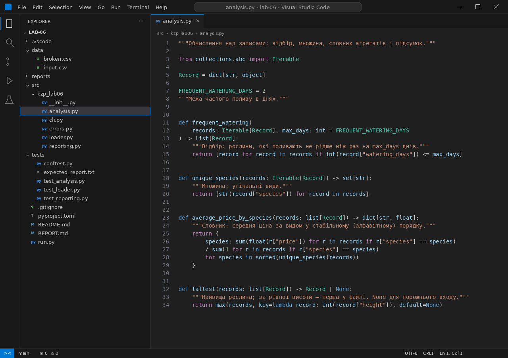
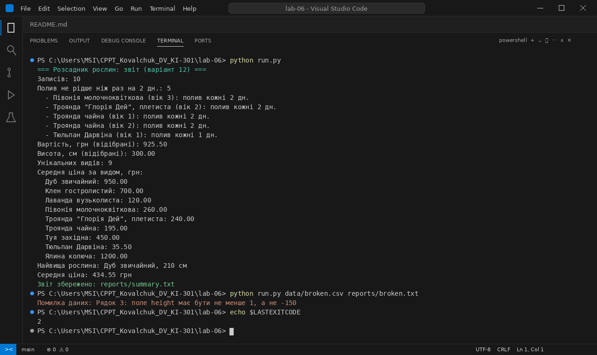
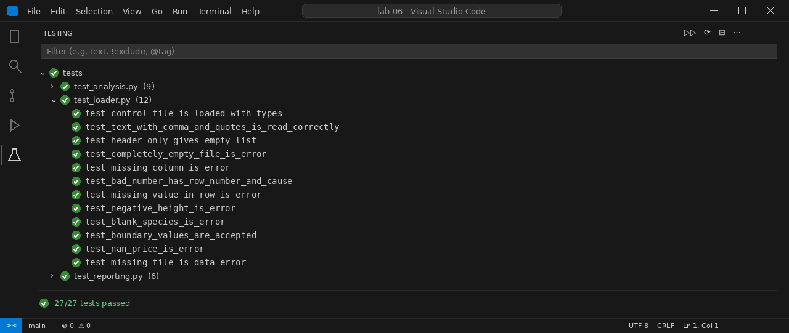

**Лабораторна робота №6**

Обробка даних засобами Python.

**Мета роботи:** створити невеликий Python-застосунок, який читає CSV,
перетворює текстові поля на типізовані значення, будує звіт за списками,
словниками й множинами та записує результат у текстовий файл. Проєкт
поділено на модулі, помилки обробляються явно, а поведінка перевіряється
через pytest.

**Завдання:** описати пакет у pyproject.toml; прочитати CSV через
csv.DictReader з UTF-8; перетворити поля на int/float; реалізувати
відбір, агрегування за ключем і унікальні значення; функцію з типовим
параметром, \*args і \*\*kwargs; модулі loader, analysis, reporting,
errors, cli; тести pytest, ruff і wheel.

**Індивідуальне завдання:**

| 12  | Розсадник рослин. Поля: species,age,height,price,watering_days; відбір – watering_days \<= 2; словник – середня ціна за species; множина – види; звіт – найвища рослина й середня ціна. |
|-----|-----------------------------------------------------------------------------------------------------------------------------------------------------------------------------------------|

**Посилання на репозиторій:**

| Репозиторій             | [<u>https://github.com/kovalchukdima0511-ai/CPPT_Kovalchuk_DV_KI-301</u>](https://github.com/kovalchukdima0511-ai/CPPT_Kovalchuk_DV_KI-301)                                                       |
|-------------------------|---------------------------------------------------------------------------------------------------------------------------------------------------------------------------------------------------|
| Код роботи (тег v1.5.0) | [<u>https://github.com/kovalchukdima0511-ai/CPPT_Kovalchuk_DV_KI-301/tree/v1.5.0/lab-06</u>](https://github.com/kovalchukdima0511-ai/CPPT_Kovalchuk_DV_KI-301/tree/v1.5.0/lab-06)                 |
| Звіт у репозиторії      | [<u>https://github.com/kovalchukdima0511-ai/CPPT_Kovalchuk_DV_KI-301/blob/main/lab-06/REPORT.md</u>](https://github.com/kovalchukdima0511-ai/CPPT_Kovalchuk_DV_KI-301/blob/main/lab-06/REPORT.md) |
| GitHub Actions          | [<u>https://github.com/kovalchukdima0511-ai/CPPT_Kovalchuk_DV_KI-301/actions/workflows/ci.yml</u>](https://github.com/kovalchukdima0511-ai/CPPT_Kovalchuk_DV_KI-301/actions/workflows/ci.yml)     |

**1. Формат CSV**

Вхідні дані — ті самі 10 рослин, що їх експортував Java-застосунок у
роботі №5, з англомовними машинними назвами стовпців. Вид із комою й
лапками записано за правилами CSV.

<table>
<colgroup>
<col style="width: 100%" />
</colgroup>
<thead>
<tr class="header">
<th>
species,age,height,price,watering_days

Туя західна,3,120,450.00,3

Троянда чайна,1,45,180.00,2

Дуб звичайний,5,210,950.00,7

Лаванда вузьколиста,2,35,120.00,3

Клен гостролистий,4,180,700.00,5

Тюльпан Дарвіна,1,40,35.50,1

Півонія молочноквіткова,3,70,260.00,2

Ялина колюча,6,180,1200.00,6

Троянда чайна,2,55,210.00,2

"Троянда ""Глорія Дей"", плетиста",2,90,240.00,2
</th>
</tr>
</thead>
<tbody>
</tbody>
</table>

*Рис. 1. Вхідний файл data/input.csv*

| **Поле**      | **Тип** | **Правило**                             |
|---------------|---------|-----------------------------------------|
| species       | str     | не порожній, зайві пробіли прибираються |
| age           | int     | ≥ 0                                     |
| height        | int     | ≥ 1                                     |
| price         | float   | ≥ 0, не NaN і не нескінченність         |
| watering_days | int     | ≥ 1                                     |

Порожній файл без заголовка — помилка; файл лише із заголовком —
коректний порожній набір. Параметри варіанта: поріг поливу
max_watering_days = 2 (десяткове ціле).

**2. Структура модулів**

| **Модуль**   | **Відповідальність**                                                        |
|--------------|-----------------------------------------------------------------------------|
| errors.py    | DataError(ValueError) — помилка формату або значення                        |
| loader.py    | читання CSV, перевірка заголовка, перетворення типів, номер рядка в помилці |
| analysis.py  | відбір, множина, словник агрегатів, make_summary — без роботи з файлами     |
| reporting.py | детермінований текст звіту й запис через with — без читання CSV             |
| cli.py       | argparse, коди завершення 0 і 2, повідомлення в stderr                      |
| run.py       | запуск у VS Code без встановлення пакета (додає src до sys.path)            |

**3. Завантаження та перетворення**

<table>
<colgroup>
<col style="width: 100%" />
</colgroup>
<thead>
<tr class="header">
<th>
def load_records(path: Path) -&gt; list[Record]:

"""Читає CSV-файл UTF-8 і повертає записи.

Порожній файл без заголовка є помилкою; файл лише із заголовком дає
порожній список.

"""

try:

with path.open("r", encoding="utf-8", newline="") as source:

reader = csv.DictReader(source)

if reader.fieldnames is None:

raise DataError(f"Файл {path} порожній: немає заголовка CSV")

missing = [field for field in FIELDS if field not in
reader.fieldnames]

if missing:

raise DataError(f"У заголовку CSV немає стовпців: {',
'.join(missing)}")

return [parse_row(row, row_number) for row_number, row in
enumerate(reader, start=2)]

except OSError as error:

raise DataError(f"Не вдалося прочитати файл: {path}") from error

def _to_int(row: dict[str, str], field: str, row_number: int,
minimum: int) -&gt; int:

"""Перетворює поле на ціле число, не менше за minimum."""

try:

value = int(row[field].strip())

except (AttributeError, KeyError, TypeError, ValueError) as
error:

raise DataError(f"Рядок {row_number}: поле {field} має бути цілим
числом") from error

if value &lt; minimum:

raise DataError(

f"Рядок {row_number}: поле {field} має бути не менше {minimum}, а не
{value}"

)

return value
</th>
</tr>
</thead>
<tbody>
</tbody>
</table>

*Лістинг 1. Читання та перетворення полів (loader.py)*

> • **newline=""** передає керування роздільниками рядків модулю csv,
> тому поле з перенесенням рядка не ламається.
>
> • **raise … from error** зберігає першопричину (ValueError, KeyError)
> у \_\_cause\_\_; голого except немає.
>
> • **OSError** (немає файлу, немає доступу) перетворюється на DataError
> з шляхом до файлу.

**4. Колекції, comprehensions і функції**

<table>
<colgroup>
<col style="width: 100%" />
</colgroup>
<thead>
<tr class="header">
<th>
def frequent_watering(

records: Iterable[Record], max_days: int = FREQUENT_WATERING_DAYS

) -&gt; list[Record]:

"""Відбір: рослини, які поливають не рідше ніж раз на max_days
днів."""

return [record for record in records if int(record["watering_days"])
&lt;= max_days]

def unique_species(records: Iterable[Record]) -&gt; set[str]:

"""Множина: унікальні види."""

return {str(record["species"]) for record in records}

def average_price_by_species(records: list[Record]) -&gt; dict[str,
float]:

"""Словник: середня ціна за видом у стабільному (алфавітному)
порядку."""

return {

species: sum(float(r["price"]) for r in records if r["species"] ==
species)

/ sum(1 for r in records if r["species"] == species)

for species in sorted(unique_species(records))

}

def make_summary(

records: list[Record],

*metrics: str,

max_watering_days: int = FREQUENT_WATERING_DAYS,

**labels: str,

) -&gt; dict[str, object]:

"""Формує підсумок звіту.

*metrics — числові поля, суми яких рахуються для відібраних
записів;

max_watering_days — поріг відбору (типове значення 2);

**labels — підписи метрик у звіті, наприклад price="Вартість".

"""

for metric in metrics:

if metric not in ("age", "height", "price", "watering_days"):

raise ValueError(f"Невідома метрика: {metric}")

selected = frequent_watering(records, max_watering_days)

top = tallest(records)

return {

"count": len(records),

"max_watering_days": max_watering_days,

"selected": sorted(selected, key=lambda r: (str(r["species"]),
int(r["age"]))),

"species": unique_species(records),

"average_price_by_species": average_price_by_species(records),

"tallest": top,

"average_price": average_price(records),

"metrics": {

labels.get(metric, metric): float(sum(float(r[metric]) for r in
selected))

for metric in metrics

},

}
</th>
</tr>
</thead>
<tbody>
</tbody>
</table>

*Лістинг 2. Відбір, множина, словник і функція з \*args/\*\*kwargs
(analysis.py)*

| **Вимога**                   | **Реалізація**                                                  |
|------------------------------|-----------------------------------------------------------------|
| список + list comprehension  | frequent_watering — рослини з поливом ≤ 2 дні                   |
| множина + set comprehension  | unique_species — 9 видів (дубль троянди відкидається)           |
| словник + dict comprehension | average_price_by_species — ключі в sorted-порядку               |
| типовий параметр             | max_watering_days: int = 2 (незмінне значення)                  |
| \*args                       | metrics — кортеж назв полів, суми яких рахуються для відібраних |
| **kwar**                     | labels — підписи метрик: price="Вартість, грн"                  |
| невідома метрика             | ValueError, а не мовчазний неповний звіт                        |

<table>
<colgroup>
<col style="width: 100%" />
</colgroup>
<thead>
<tr class="header">
<th>
def main(argv: list[str] | None = None) -&gt; int:

"""Читає CSV, будує звіт, друкує його та записує у файл. Повертає код
завершення."""

_use_utf8()

parser = argparse.ArgumentParser(prog="kzp-lab06", description="Звіт
розсадника рослин")

parser.add_argument("input_csv", type=Path, help="вхідний CSV
(UTF-8)")

parser.add_argument("output_report", type=Path, help="файл
звіту")

args = parser.parse_args(argv)

try:

records = load_records(args.input_csv)

summary = make_summary(

records, "price", "height", price="Вартість, грн", height="Висота,
см"

)

text = format_report(summary)

write_report(args.output_report, text)

except DataError as error:

print(f"Помилка даних: {error}", file=sys.stderr)

return EXIT_DATA_ERROR

print(text, end="")

print(f"Звіт збережено: {args.output_report.as_posix()}")

return EXIT_OK
</th>
</tr>
</thead>
<tbody>
</tbody>
</table>

*Лістинг 3. Виклик make_summary і коди завершення (cli.py)*

**5. Результат роботи**

*Рис. 2. Структура пакета та модуль analysis.py у VS Code*

*Рис. 3. Успішний запуск (код 0) і пошкоджений CSV (код 2)*

Перевірка: відібрано 5 рослин (полив 1–2 дні), їхня вартість 180 +
35.5 + 260 + 210 + 240 = 925.50 грн. Середня ціна «Троянди чайної»
(180 + 210) / 2 = 195.00. Найвища рослина — дуб, 210 см, середня ціна
434.55 грн — так само, як у Java-звіті. Для data/broken.csv програма не
створює звіт, друкує повідомлення з номером рядка в stderr і
завершується з кодом 2.

Запуск у VS Code: відкрити run.py і натиснути ▶. Повний цикл: python -m
venv .venv, .venv\Scripts\activate, python -m pip install -e ".\[dev\]",
python -m pytest, ruff check ., ruff format --check ., python -m build
--wheel, kzp-lab06 data/input.csv reports/summary.txt.

**6. Тестування та якість коду**

| **Файл тестів**   | **Що перевіряє**                                                                                                                                                                                                             |
|-------------------|------------------------------------------------------------------------------------------------------------------------------------------------------------------------------------------------------------------------------|
| test_loader.py    | типи полів, поле з комою й лапками, лише заголовок, порожній файл, відсутній стовпець, хибне число з номером рядка й cause, відсутнє значення в рядку, від'ємна висота, порожній вид, граничні значення, NaN, відсутній файл |
| test_analysis.py  | межа фільтра, порожній результат відбору, дублікати в множині, середня ціна за видом і порядок, найвища рослина й рівна висота, порожній вхід, \*args/default/\*\*kwargs, невідома метрика                                   |
| test_reporting.py | повний текст звіту = еталон, звіт для порожнього входу, запис UTF-8, CLI успіх (0) і помилка (2), імпорт без запуску CLI                                                                                                     |

*Рис. 4. Результати 27 тестів pytest у VS Code*

ruff check . і ruff format --check . проходять без зауважень (правила E,
F, W, B, UP; довжина рядка 100). CI запускає pytest, ruff, збирання
wheel і перевірку кодів завершення на Ubuntu, Windows і macOS.

**Використання ШІ:**

Під час виконання роботи використовувався ШІ-асистент Claude
(Anthropic): розбиття на модулі, пояснення csv.DictReader,
comprehensions і raise from, написання частини коду й тестів,
налаштування pyproject.toml і ruff. Усі пропозиції я переглянув,
запустив і перевірив тестами; код, який не міг пояснити, не приймав.
Відповідальність за остаточний код і звіт несу я.

**Висновок:**

На цій лабораторній роботі я створив Python-пакет із модульним
завантаженням CSV, функціями аналізу на списках, словниках і множинах,
детермінованим текстовим звітом і CLI з кодами завершення. Застосовано
comprehensions, функцію з типовим параметром, \*args і \*\*kwargs,
обробку винятків із збереженням причини, with, pytest і ruff. Наступна
робота перенесе ці обчислення на класи з @property, @dataclass і
спеціальними методами.
