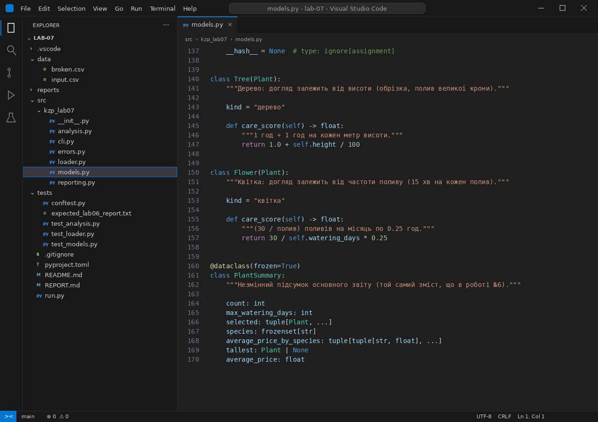
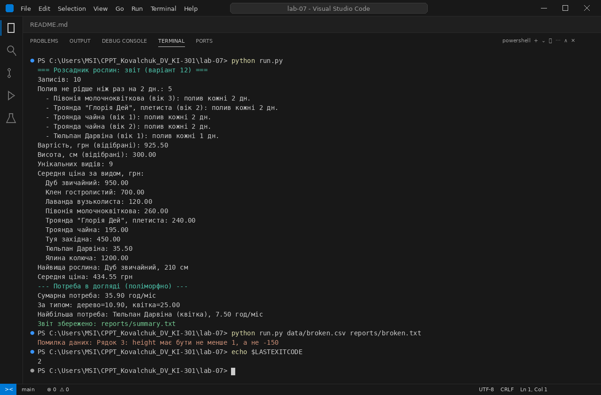
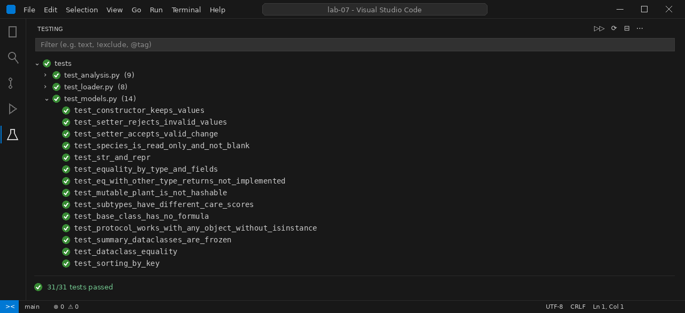

**Лабораторна робота №7**

Об'єктно-орієнтована обробка даних у Python.

**Мета роботи:** перетворити словникові записи попередньої Python-роботи
на об'єкти з власною поведінкою: додати клас-сутність з @property,
незмінний @dataclass, спеціальні методи, два підтипи зі спільним
протоколом, модульну структуру та поведінкові тести pytest.

**Завдання:** створити базовий клас Plant із \_\_init\_\_ і
setter-валідацією, підтипи Tree і Flower з різною care_score(), протокол
CareScored, @dataclass(frozen=True) для підсумків, \_\_str\_\_,
\_\_repr\_\_, \_\_eq\_\_ і впорядкування через key; перетворювати CSV на
об'єкти в loader; зберегти звіт роботи №6; тести, ruff, wheel, CI.

**Індивідуальне завдання:**

| 12  | Розсадник рослин. Plant: Tree, Flower; операція – care_score() за висотою або поливом; підсумок – потреба в догляді. |
|-----|----------------------------------------------------------------------------------------------------------------------|

**Посилання на репозиторій:**

| Репозиторій             | [<u>https://github.com/kovalchukdima0511-ai/CPPT_Kovalchuk_DV_KI-301</u>](https://github.com/kovalchukdima0511-ai/CPPT_Kovalchuk_DV_KI-301)                                                       |
|-------------------------|---------------------------------------------------------------------------------------------------------------------------------------------------------------------------------------------------|
| Код роботи (тег v1.6.0) | [<u>https://github.com/kovalchukdima0511-ai/CPPT_Kovalchuk_DV_KI-301/tree/v1.6.0/lab-07</u>](https://github.com/kovalchukdima0511-ai/CPPT_Kovalchuk_DV_KI-301/tree/v1.6.0/lab-07)                 |
| Звіт у репозиторії      | [<u>https://github.com/kovalchukdima0511-ai/CPPT_Kovalchuk_DV_KI-301/blob/main/lab-07/REPORT.md</u>](https://github.com/kovalchukdima0511-ai/CPPT_Kovalchuk_DV_KI-301/blob/main/lab-07/REPORT.md) |
| GitHub Actions          | [<u>https://github.com/kovalchukdima0511-ai/CPPT_Kovalchuk_DV_KI-301/actions/workflows/ci.yml</u>](https://github.com/kovalchukdima0511-ai/CPPT_Kovalchuk_DV_KI-301/actions/workflows/ci.yml)     |

**1. Від словника до об'єкта**

| **Аспект**            | **Робота №6**       | **Робота №7**                                     |
|-----------------------|---------------------|---------------------------------------------------|
| Запис                 | dict\[str, object\] | екземпляр Tree або Flower                         |
| Перевірка             | функції loader      | setter-и властивостей і конструктор               |
| Поведінка             | зовнішні функції    | методи care_score(), needs_frequent_watering()    |
| Відмінності категорій | —                   | підтипи зі спільним протоколом CareScored         |
| Підсумок              | словник             | @dataclass(frozen=True) PlantSummary, CareSummary |
| Звіт                  | —                   | та сама основна частина + розділ догляду          |

**2. Базовий клас і властивості**

<table>
<colgroup>
<col style="width: 100%" />
</colgroup>
<thead>
<tr class="header">
<th>
@property

def height(self) -&gt; int:

"""Висота в сантиметрах."""

return self._height

@height.setter

def height(self, value: int) -&gt; None:

"""Встановлює додатну висоту."""

self._height = _check_int("height", value, 1)

@property

def price(self) -&gt; float:

"""Ціна в гривнях."""

return self._price

@price.setter

def price(self, value: float) -&gt; None:

"""Встановлює невід'ємну скінченну ціну."""

if isinstance(value, bool) or not isinstance(value, int | float):

raise TypeError("price має бути числом")

if not math.isfinite(value) or value &lt; 0:

raise ValueError("price має бути невід'ємним скінченним числом")

self._price = float(value)
</th>
</tr>
</thead>
<tbody>
</tbody>
</table>

*Лістинг 1. Властивості з перевіркою у setter (models.py)*

> • **species** — властивість лише для читання: вид рослини не
> змінюється, setter не надано.
>
> • **age, height, price, watering_days** — setter перевіряє тип і межу
> та записує у внутрішнє поле \_height; запис у self.height усередині
> setter спричинив би рекурсію.
>
> • **Конструктор** присвоює значення через властивості, тому ті самі
> перевірки діють і під час створення, і під час зміни.
>
> • **bool** відхиляється як тип, хоча в Python True є підкласом int.

**3. Підтипи, протокол і спеціальні методи**

<table>
<colgroup>
<col style="width: 100%" />
</colgroup>
<thead>
<tr class="header">
<th>
class Tree(Plant):

"""Дерево: догляд залежить від висоти (обрізка, полив великої
крони)."""

kind = "дерево"

def care_score(self) -&gt; float:

"""1 год + 1 год на кожен метр висоти."""

return 1.0 + self.height / 100

class Flower(Plant):

"""Квітка: догляд залежить від частоти поливу (15 хв на кожен
полив)."""

kind = "квітка"

def care_score(self) -&gt; float:

"""(30 / полив) поливів на місяць по 0.25 год."""

return 30 / self.watering_days * 0.25

class CareScored(Protocol):

"""Протокол: об'єкт має вид і вміє оцінити потребу в догляді."""

@property

def species(self) -&gt; str:

"""Вид рослини."""

...

@property

def kind(self) -&gt; str:

"""Категорія для звіту."""

...

def care_score(self) -&gt; float:

"""Години догляду на місяць."""

...
</th>
</tr>
</thead>
<tbody>
</tbody>
</table>

*Лістинг 2. Підтипи та протокол (models.py)*

Формули ті самі, що в Java-ієрархії робіт №3–5, тому сумарна потреба в
догляді в обох мовах — 35.90 год/міс. Функції аналізу most_demanding,
care_by_kind і make_care_summary приймають будь-який об'єкт з species,
kind і care_score() — це качина типізація: тест передає сторонній клас
«Газон», і він обробляється без змін коду. Перевірок isinstance в
analysis немає; підтип вибирається один раз — у фабриці
loader.plant_class за родом рослини.

<table>
<colgroup>
<col style="width: 100%" />
</colgroup>
<thead>
<tr class="header">
<th>
def __eq__(self, other: object) -&gt; bool:

"""Рівні, якщо це той самий підтип і всі поля збігаються."""

if not isinstance(other, Plant):

return NotImplemented

return type(self) is type(other) and self._fields() ==
other._fields()

def __repr__(self) -&gt; str:

"""Діагностичне подання."""

return (

f"{type(self).__name__}(species={self.species!r}, age={self.age!r},
"

f"height={self.height!r}, price={self.price!r},
watering_days={self.watering_days!r})"

)
</th>
</tr>
</thead>
<tbody>
</tbody>
</table>

*Лістинг 3. Рівність і діагностичне подання (models.py)*

| **Метод**           | **Поведінка**                                                                          |
|---------------------|----------------------------------------------------------------------------------------|
| \_\_str\_\_         | «Дуб звичайний \[дерево\]: 5 р., 210 см, 950.00 грн, полив кожні 7 дн.» — для читача   |
| \_\_repr\_\_        | Tree(species='Дуб звичайний', age=5, …) — для розробника                               |
| \_\_eq\_\_          | той самий підтип і всі поля; для чужого типу — NotImplemented                          |
| \_\_hash\_\_ = None | стан змінюється через setter-и, тому об'єкт не можна класти в set чи брати ключем dict |
| впорядкування       | sorted(..., key=lambda p: (-p.height, p.species)) у analysis                           |

**4. Dataclass і безпечний запис звіту**

<table>
<colgroup>
<col style="width: 100%" />
</colgroup>
<thead>
<tr class="header">
<th>
@dataclass(frozen=True)

class CareSummary:

"""Незмінний підсумок потреби в догляді."""

total: float

by_kind: tuple[tuple[str, float], ...]

most_demanding: CareScored | None
</th>
</tr>
</thead>
<tbody>
</tbody>
</table>

*Лістинг 4. Незмінний підсумок (models.py)*

frozen=True забороняє змінювати поля після створення
(FrozenInstanceError). Колекції всередині підсумків — кортежі та
frozenset, тому незмінність не лише поверхнева. Завдання із зірочкою:
контекстний менеджер report_writer пише звіт у тимчасовий файл і замінює
ним старий лише після успішного блоку with; під час винятку тимчасовий
файл видаляється, а старий звіт лишається цілим.

<table>
<colgroup>
<col style="width: 100%" />
</colgroup>
<thead>
<tr class="header">
<th>
@contextmanager

def report_writer(path: Path) -&gt; Iterator[TextIO]:

"""Контекстний менеджер безпечного запису.

Текст пишеться в тимчасовий файл і замінює звіт лише після успішного
завершення

блоку with. Якщо в блоці виник виняток, тимчасовий файл видаляється,
а старий звіт

залишається без змін.

"""

path.parent.mkdir(parents=True, exist_ok=True)

temporary = path.with_name(path.name + ".tmp")

target = temporary.open("w", encoding="utf-8", newline="\n")

try:

yield target

except BaseException:

target.close()

temporary.unlink(missing_ok=True)

raise

target.close()

os.replace(temporary, path)
</th>
</tr>
</thead>
<tbody>
</tbody>
</table>

*Лістинг 5. Контекстний менеджер запису (reporting.py)*

**5. Результат роботи**

*Рис. 1. Структура пакета та підтипи в models.py у VS Code*

*Рис. 2. Успішний запуск (код 0) і пошкоджений CSV (код 2)*

Основна частина звіту побайтово збігається з роботою №6 (тест
test_main_report_is_equivalent_to_lab06 порівнює з еталонним файлом).
Новий розділ: дерева 10.90 год, квіти 25.00 год, разом 35.90 год/міс,
найбільша потреба — тюльпан (7.50). Запуск у VS Code: run.py → ▶; повний
цикл — так само, як у роботі №6, з командою kzp-lab07.

**6. Тестування**

| **Файл тестів**  | **Що перевіряє**                                                                                                                                                                                                                                                                                                           |
|------------------|----------------------------------------------------------------------------------------------------------------------------------------------------------------------------------------------------------------------------------------------------------------------------------------------------------------------------|
| test_models.py   | конструктор і нормалізація виду, setter-и відхиляють значення й тип, дозволена зміна, species лише для читання, \_\_str\_\_/\_\_repr\_\_, \_\_eq\_\_ і NotImplemented, нехешованість, різні care_score, базовий клас без формули, протокол зі стороннім класом, frozen dataclass, рівність dataclass, сортування через key |
| test_loader.py   | 4 дерева й 6 квітів, вибір підтипу за родом, невідомий рід, порушення інваріанта з номером рядка й cause, хибне число, відсутнє значення, порожні входи, відсутній стовпець                                                                                                                                                |
| test_analysis.py | еквівалентність зі звітом роботи №6, розділ догляду, \*args/\*\*kwargs, невідома метрика, порожній вхід, контекстний менеджер (успіх і виняток), CLI 0 і 2                                                                                                                                                                 |

*Рис. 3. Результати 31 тестів pytest у VS Code*

**Використання ШІ:**

Під час виконання роботи використовувався ШІ-асистент Claude
(Anthropic): пояснення @property, dataclass і Protocol на коді проєкту,
написання частини класів і тестів, реалізація контекстного менеджера,
рецензування відсутності isinstance в analysis. Усі пропозиції я
переглянув, запустив і перевірив тестами; код, який не міг пояснити, не
приймав. Відповідальність за остаточний код і звіт несу я.

**Висновок:**

На цій лабораторній роботі я перевів Python-застосунок зі словників на
об'єкти: базовий клас Plant контролює стан через @property, підтипи Tree
і Flower мають власні формули care_score(), спільна поведінка описана
протоколом CareScored, а підсумки — незмінними dataclass. Спеціальні
методи підключили об'єкти до print, repr і ==. Основний звіт не
змінився, а результати догляду збіглися з Java-реалізацією, що
підтверджує узгодженість усього наскрізного продукту.
